# Smart Home — überarbeitete Fassung

Überarbeitung der Markdown-Konvertierung von `Smart Home.pdf` (Original: 97 Folien).
Quelle unverändert: `Smart Home.md`. Schaubilder liegen weiterhin in `images/` bzw. `images/pages/`; alle Bildpfade sind unverändert übernommen.

**Lesehilfe:** Jede Passage, die nicht aus der PDF-Konvertierung stammt, ist mit `<!-- NEU -->` direkt davor markiert. Alles ohne diese Markierung ist Originaltext (wörtlich, bis auf die unten in der Fehlerliste genannten Korrekturen).

Gestrichene Original-Passagen stehen vollständig im Anhang **„Gestrichenes Material"** am Dateiende — es wurde nichts gelöscht.

<!-- NEU -->
## Mapping: neue Folienposition → alte Foliennummer

| Neu | Teil | Titel (neu) | Alt |
|---|---|---|---|
| 1 | 0 | Smart Home (Titel) | F1 |
| 2 | 0 | Teil 0 — Einstieg | F70 (Leerfolie recycelt) |
| 3 | 0 | Agenda | F2 (neu formuliert) |
| 4 | 0 | Was ist Smart Home? | F3 |
| 5 | 0 | Was ist ihr Zweck? | F4 |
| 6 | 1 | Teil 1 — Aufbau: Die vier Schichten | F71 (Leerfolie recycelt) |
| 7 | 1 | Der Aufbau von SH | F5 |
| 8 | 1 | Schicht 1 — Die Feldebene: Sensoren und Aktoren | F6 |
| 9 | 1 | Schicht 2 — Die Übertragungsebene: Protokolle | F7 |
| 10 | 1 | Schicht 2 (Forts.) — Kabelsysteme | F8 |
| 11 | 1 | Schicht 2 (Forts.) — Netzwerkkabel | F9 |
| 12 | 1 | Schicht 2 (Forts.) — Busleitung | F10 |
| 13 | 1 | Schicht 2 (Forts.) — Schaltschrank | F11 |
| 14 | 1 | Schicht 2 (Forts.) — Aufbau des Schaltschranks | F12 |
| 15 | 1 | Schicht 3 — Die Steuerungsebene: Gateway / Hub | F13 |
| 16 | 1 | Schicht 4 — Die Bedienebene: Benutzerschnittstellen | F14 (Begriff korrigiert) |
| 17 | 1 | Zusammenfassung Teil 1: Ablauf von Smart Home | F15 |
| 18 | 1 | Zusammenfassung Teil 1: Beispiel für den Ablauf | F16 |
| 19 | 2 | Teil 2 — Exkurs: Wie die Zentrale denkt | F86 (Leerfolie recycelt) |
| 20 | 2 | Einfaches Python Script | F17 |
| 21 | 2 | Hysterese | F18 |
| 22 | 2 | Einfaches Python Script mit Hysterese | F19 |
| 23 | 2 | Die Scriptlogik (Python) | F20 (Tippfehler korrigiert) |
| 24 | 2 | Beispiel: Automatisierung „Keller Bad" | F21 |
| 25 | 3 | Teil 3 — Systeme im Vergleich | F93 (Leerfolie recycelt) |
| 26 | 3 | Vergleichsmatrix: Tuya, Zigbee, Matter | neu |
| 27 | 3 | Tuya: Vorteile | F22 |
| 28 | 3 | Tuya: Nachteile | F23 |
| 29 | 3 | Tuya: Die drei Kommunikationswege | F29 |
| 30 | 3 | Tuya: System-Architektur | F30 |
| 31 | 3 | Zigbee: Vorteile | F24 |
| 32 | 3 | Zigbee: Nachteile | F25 |
| 33 | 3 | Zigbee: Architektur & lokaler Kommunikationsgraph | F32 |
| 34 | 3 | Matter | F26 |
| 35 | 3 | Matter: Vorteile | F27 |
| 36 | 3 | Matter: Nachteile | F28 |
| 37 | 3 | Matter: Der Controller (Steuerzentrale) | F33 |
| 38 | 3 | Matter: Der Thread Border Router | F34 |
| 39 | 3 | Matter: Die Endgeräte (WLAN oder Thread) | F35 |
| 40 | 3 | Matter: Ablauf eines typischen Schaltbefehls | F36 |
| 41 | 3 | Lokal vs. Cloud — der entscheidende Unterschied | F31 + F37 (Dubletten zusammengeführt) |
| 42 | 3 | Abschluss Teil 3: Vergleichsmatrix | neu |
| 43 | 4 | Teil 4 — Risiken | F95 (Leerfolie recycelt) |
| 44 | 4 | Gefahren und Fallstricke von Cloudanbietern | F38 |
| 45 | 4 | Drittland-Risiko am Beispiel China | F39–F42 (verdichtet) |
| 46 | 4 | Leitfrage: Welche Daten verlassen das Haus? | neu |
| 47 | 4 | IT-Sicherheit: die zweite Risikoebene | neu |
| 48 | 4 | Lebensdauer-Risiko: wenn der Hersteller abschaltet | neu |
| 49 | 5 | Teil 5 — Anbieter | F96 (Leerfolie recycelt) |
| 50 | 5 | Gibt es deutsche Anbieter? | F46 |
| 51 | 5 | Block A — DSGVO-konform: der Vorteil | F47 (ausformuliert) |
| 52 | 5 | Block A — Smart-Home-Systeme deutscher Anbieter | F48 |
| 53 | 5 | Block A — wibutler | F49 |
| 54 | 5 | Block A — Partner von wibutler | F50 |
| 55 | 5 | Block A — Bosch Smart Home | F51 |
| 56 | 5 | Block B — Verbreitet, aber Cloud: was das bedeutet | neu |
| 57 | 5 | Block B — Xiaomi Home App | F52 |
| 58 | 5 | Block B — Google Home | F53 |
| 59 | 5 | Block C — Praxis-Screenshots aus dem Betrieb | neu |
| 60 | 5 | Praxis: Heizkreis-Steuerung | F54 |
| 61 | 5 | Praxis: Energiemonitoring | F55 |
| 62 | 5 | Praxis: Energiemonitoring — Jahresverlauf | F56 |
| 63 | 5 | Praxis: Wärmeerzeuger und Anlagen-Monitoring | F57 |
| 64 | 5 | Praxis: tado° App | F58 |
| 65 | 5 | Praxis: Kamera Hauseingang | F59 |
| 66 | 5 | Home Assistant | F60 (Tippfehler korrigiert) |
| 67 | 5 | Home Assistant: Dashboards & Automationen | F61 |
| 68 | 5 | Home Assistant: Grundprinzipien | F62 |
| 69 | 5 | Hardware für Home Assistant OS | F63 |
| 70 | 5 | Unterschied zu anderen Varianten (Docker / Core) | F64 |
| 71 | 5 | Home Assistant: Integrationen | F65 |
| 72 | 5 | Home Assistant: Dashboard | F66 |
| 73 | 5 | Home Assistant auf Smartphone und Smartwatch | F67 |
| 74 | 5 | Home Assistant: Wanddisplay / Tablet-Dashboard | F68 |
| 75 | 5 | Fazit Home Assistant | F69 (umbenannt) |
| 76 | 6 | Teil 6 — Workshop: drei Fälle | neu |
| 77 | 6 | Das Raster für alle drei Fälle | neu |
| 78 | 6 | Fall 1 — Aufgabe: Neubau | F94 (fehlendes Wort ergänzt) |
| 79 | 6 | Fall 1 — Neubau: Ausgangslage | neu |
| 80 | 6 | Neubau — Infrastruktur (Das Fundament) | F74 + F81/F82 („Im Neubau") |
| 81 | 6 | Neubau — Heizung, Lüftung & Klima (HVAC) | F75 + F83 („Im Neubau") |
| 82 | 6 | Neubau — Beleuchtung & Beschattung | F76 + F84 („Im Neubau") |
| 83 | 6 | Neubau — Sicherheit & Zutritt | F77 |
| 84 | 6 | Neubau — Wichtige Planungs-Tipps für die Praxis | F78 |
| 85 | 6 | Fall 2 — Aufgabe: Kernsanierung | F72 |
| 86 | 6 | Fall 2 — Kernsanierung als Chance | F73 |
| 87 | 6 | Frage: Sanierung vs. Neubau | F79 |
| 88 | 6 | Antwort: Sanierung vs. Neubau | F80 |
| 89 | 6 | Sanierung — Infrastruktur: Statik, Wände, Schlitze | F81 („In der Kernsanierung") |
| 90 | 6 | Sanierung — Infrastruktur: Platz für den Schaltschrank | F82 („In der Kernsanierung") |
| 91 | 6 | Sanierung — HVAC: Fußbodenaufbau und Heizung | F83 („In der Kernsanierung") |
| 92 | 6 | Sanierung — Beleuchtung & Beschattung: Fenster | F84 („In der Kernsanierung") |
| 93 | 6 | Sanierung — Sicherheit & Zutritt | neu |
| 94 | 6 | Sanierung — Hybrid-Lösung: der Geheimtipp | F85 |
| 95 | 6 | Fall 3 — Aufgabe: Eigentums- oder Mietwohnung | F87 |
| 96 | 6 | Fall 3 — Mietwohnung: Ausgangslage | F88 |
| 97 | 6 | Mietwohnung — Infrastruktur: Funksystem wählen | F89 |
| 98 | 6 | Mietwohnung — Heizung & Klima | F91 (+ Überschrift aus F90) |
| 99 | 6 | Mietwohnung — Beleuchtung & Strom | F90 |
| 100 | 6 | Mietwohnung — Zutritt & Sicherheit | F92 |
| 101 | 6 | Mietwohnung — Was entfällt | neu |
| 102 | 7 | Teil 7 — Entscheidung & Abschluss | neu |
| 103 | 7 | Entscheidungshilfe: Welches System für welchen Fall? | neu |
| 104 | 7 | Kosten: Größenordnungen (Platzhalter) | neu |
| 105 | 7 | Energieeinsparung: was noch zu belegen ist | neu |
| 106 | 7 | Gesamt-Fazit | neu |
| 107 | 7 | Quellen & offene Belege | neu |
| 108 | 7 | Fragen? | F97 |
| A | — | Anhang: Gestrichenes Material | F43, F44, F45 + Langfassungen F39–F42 |

<!-- NEU -->
## Korrigierte Fehler aus dem Original

| Alt | Original (wörtlich) | Korrektur |
|---|---|---|
| F14 | „4. Die Unternehmensebene" | „4. Die Bedienebene" — „Unternehmensebene" stammt aus der Automatisierungspyramide (ISA-95) und bezeichnet dort die ERP-/Betriebsleitebene; für die Bedienoberfläche im Wohnhaus unpassend |
| F7 | „Die Übertragungsebene" (ohne Nummer) | „2. Die Übertragungsebene" — Nummerierung 1–4 durchgezogen |
| F20 | „Die Scriptlogik (Pyton)" | „Die Scriptlogik (Python)" |
| F60 | „Home Assistent ist ein dafür ein Beispiel" | „Home Assistant ist dafür ein Beispiel" (Produktname + doppeltes „ein") |
| F41 | „… ist damit kaum zu garantiere" | „… ist damit kaum zu garantieren." |
| F94 | „Welche ist möglich?" | „Welche Ausstattung ist möglich?" |
| F47 | nur das Wort „Vorteil:" | ausformuliert (siehe Folie 51) |
| F18 | Verweis „[1, 2]" ohne Literaturverzeichnis | Marker entfernt, offener Beleg auf der Quellenfolie 107 vermerkt |

---

# Teil 0 — Einstieg

## Folie 1 — Smart Home

### Smart Home

NILS NIEMEIER

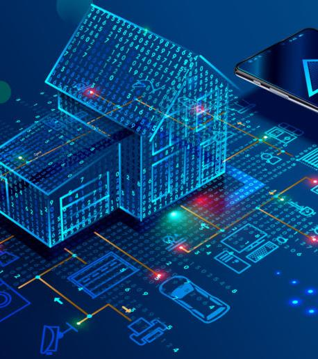

> **Beschreibung:** Isometrische, digital wirkende Illustration eines Hauses, dessen Dach und Wände aus fließendem Binärcode (Ziffernkolonnen) und leuchtenden hellblauen Linien bestehen. Auf dem Boden liegt ein Schaltplan-artiges Raster mit Symbolen für Geräte (u. a. Auto, Monitor, Heizung), verbunden durch goldene Leitungen mit roten und grünen Leuchtpunkten. Rechts oben ragt ein Smartphone ins Bild. Die Grafik steht für Vernetzung und Digitalisierung eines Gebäudes.

---

<!-- NEU -->
## Folie 2 — Teil 0: Einstieg

### Teil 0 — Einstieg

Was Smart Home ist, wozu es gut ist und was heute auf dem Programm steht.

*(Kapiteltrennfolie — recycelt aus der funktionslosen Leerfolie F70.)*

---

<!-- NEU -->
## Folie 3 — Agenda

### Agenda

| Teil | Thema |
|---|---|
| **0** | Einstieg: Was ist Smart Home, was ist der Zweck |
| **1** | Aufbau: Die vier Schichten — von der Hardware bis zur Bedienung |
| **2** | Exkurs: Wie die Zentrale denkt (Logik & Hysterese) |
| **3** | Systeme im Vergleich: Tuya, Zigbee, Matter |
| **4** | Risiken: Cloud-Abhängigkeit, Datenschutz, IT-Sicherheit, Lebensdauer |
| **5** | Anbieter: DSGVO-konform, Cloud-basiert, und Home Assistant |
| **6** | **Workshop (interaktiv):** Neubau → Kernsanierung → Mietwohnung |
| **7** | Entscheidungshilfe, Fazit, Quellen, Fragen |

> **Hinweis für den Vortragenden:** Teil 6 ist ein interaktiver Workshop mit drei Aufgaben. Er macht etwa ein Viertel des Vortrags aus und sollte entsprechend Zeit bekommen.

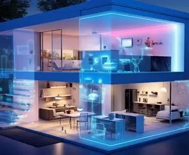

> **Beschreibung:** Gerenderte Ansicht eines zweistöckigen, modernen Wohnhauses in Abend- bzw. Nachtstimmung. Die Fassade ist teils transparent dargestellt, sodass Wohnzimmer, Küche und Schlafzimmer sichtbar sind. Blaue und pinkfarbene LED-Lichtleisten sowie leuchtende blaue Symbol-Overlays deuten auf vernetzte Gebäudetechnik hin. Das Bild vermittelt ein komfortables, automatisiertes Zuhause.

> *Original-Agenda (F2) zum Vergleich — vollständig erhalten im Anhang „Gestrichenes Material".*

---

## Folie 4 — Was ist Smart Home?

**Smart Home ist die Haus- und Gebäudeautomation, bzw. Domotik und Domotronik.**
**Im Bauwesen bezeichnet sie die Gesamtheit der:**

- Überwachungs-,
- Steuer-,
- Regel- und
- Optimierungseinrichtungen

in Gebäuden.

---

## Folie 5 — Was ist ihr Zweck?

- Wohn- und Lebensqualität verbessern
- Sicherheit erhöhen
- effizienter Energienutzung gewährleisten
- auf Basis vernetzter und fernsteuerbarer Geräte und Installationen sowie automatisierbarer Abläufe

---

# Teil 1 — Aufbau: Die vier Schichten

<!-- NEU -->
## Folie 6 — Teil 1: Aufbau — Die vier Schichten

### Teil 1 — Aufbau: Die vier Schichten

Feldebene → Übertragungsebene → Steuerungsebene → Bedienebene. Vier Schichten, die zusammenarbeiten müssen.

*(Kapiteltrennfolie — recycelt aus der funktionslosen Leerfolie F71.)*

---

## Folie 7 — Der Aufbau von SH

Der **Aufbau eines Smart Homes** lässt sich am besten als ein Vier-Schichten-Modell verstehen. Damit aus normalen Geräten ein intelligentes Zuhause wird, müssen Hardware, Übertragungswege, die zentrale Logik und die Benutzeroberfläche nahtlos zusammenarbeiten.

---

## Folie 8 — Die 4 Schichten des Smart Homes

### 1. Die Feldebene: Sensoren und Aktoren (Die Hardware)

Die physischen Geräte im Haus werden in zwei Hauptgruppen unterteilt:

- **Sensoren (Die "Sinnesorgane"):** Sie nehmen Informationen aus der Umwelt auf und senden sie weiter.
  - *Beispiele:* Bewegungsmelder, Rauchmelder, Fensterkontakte, Temperatursensoren.
- **Aktoren (Die "Muskeln"):** Sie empfangen Befehle und führen eine Aktion aus.
  - *Beispiele:* Smarte Unterputz-Relais (für Licht), Heizkörperthermostate, motorisierte Rollo-Motoren, smarte Steckdosen.

---

## Folie 9 — 2. Die Übertragungsebene: Protokolle (Die Sprache)

<!-- NEU -->
*(Im Original trug diese Folie keine Schichtnummer — die „2." fehlte vollständig. Nummerierung hier durchgezogen.)*

**Damit die Geräte miteinander kommunizieren können, nutzen sie ein gemeinsames Protokoll. Hier wird grundsätzlich zwischen zwei Systemen unterschieden:**

- **Funksysteme (Ideal zum Nachrüsten):**
  - **Matter:** Der moderne, herstellerübergreifende IP-Standard (oft in Kombination mit **Thread**).
  - **Zigbee / Z-Wave:** Sehr energiesparende Funknetze (Mesh-Netzwerke), ideal für batteriebetriebene Sensoren.
  - **WLAN / Bluetooth:** Einfach einzurichten, verbraucht aber mehr Strom und belastet den Router bei vielen Geräten.

<!-- NEU -->
> **Die zweite Hälfte dieser Schicht sind die Kabelsysteme** — siehe die folgenden Folien 10–14.

---

## Folie 10 — Schicht 2 (Forts.): Kabelsysteme (Ideal für Neubau und Kernsanierung)

<!-- NEU -->
*Unterpunkt von Schicht 2 (Übertragungsebene) — im Original stand diese Folie als gleichrangige Folie neben den Schichten.*

- **KNX** oder **Loxone:** Die stabilste, langlebigste, aber auch teuerste Variante, bei der grüne Bus-Kabel direkt in der Wand verlegt werden.

---

## Folie 11 — Schicht 2 (Forts.): Netzwerkkabel (Bildfolie)

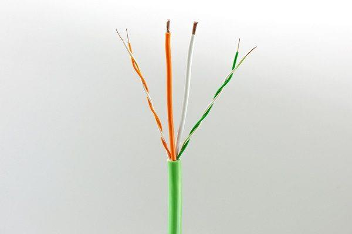

> **Beschreibung:** Foto eines einzelnen Kabels mit grüner Außenummantelung vor hellgrauem Hintergrund. Am oberen Ende sind die Adern aufgefächert: zwei verdrillte Paare (orange/weiß links, grün/weiß rechts) sowie eine einzelne orange und eine weiße Ader in der Mitte. Das Bild zeigt den inneren Aufbau eines verdrillten Adernkabels, lässt aber offen, welches konkrete Smart-Home-Protokoll dahintersteckt.

---

## Folie 12 — Schicht 2 (Forts.): Busleitung (Bildfolie)

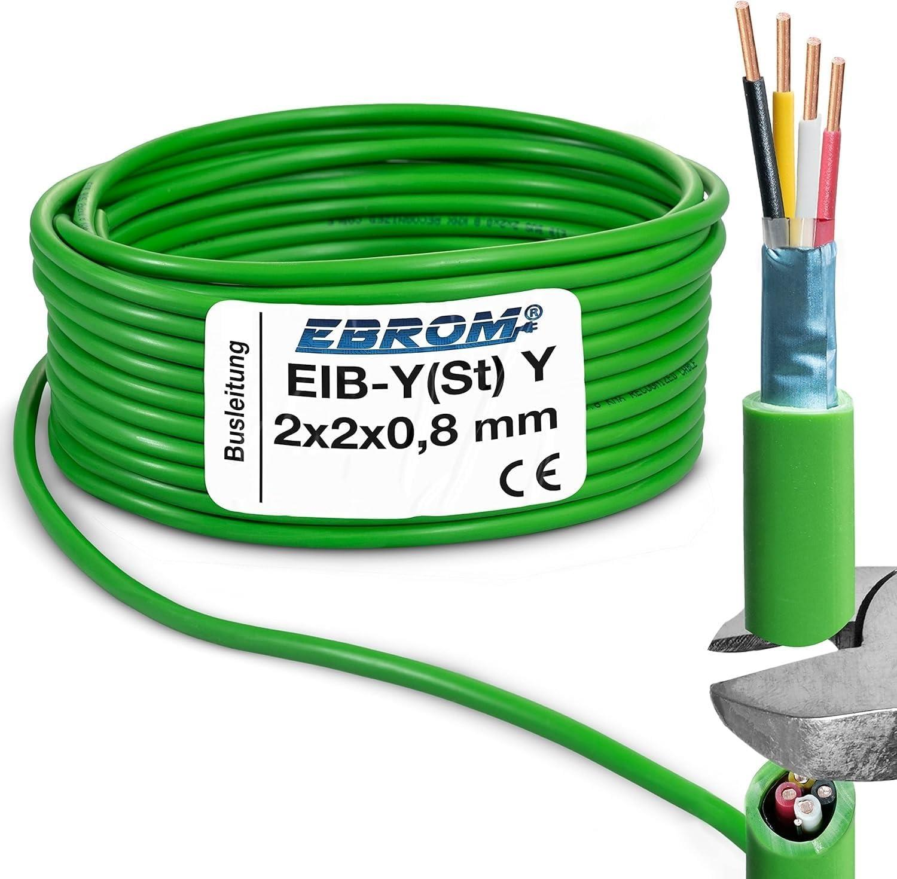

> **Beschreibung:** Produktfoto auf weißem Grund: Links liegt eine grüne Rolle Busleitung der Marke EBROM mit dem Etikett „EIB-Y(St) Y 2x2x0,8 mm“ und dem Aufdruck „Busleitung“ sowie CE-Zeichen. Rechts ist das Kabelende abisoliert: vier farbige Adern (schwarz, gelb, weiß, rot) unter einer silbernen Schirmung, daneben setzt eine Seitenschneide an. Das Bild zeigt ein Bus-Kabel für EIB-/KNX-Installationen (EIB ist der Vorläufer von KNX; Zuordnung aus dem Etikett abgeleitet).

---

## Folie 13 — Schicht 2 (Forts.): Schaltschrank (Praxisbeispiel)

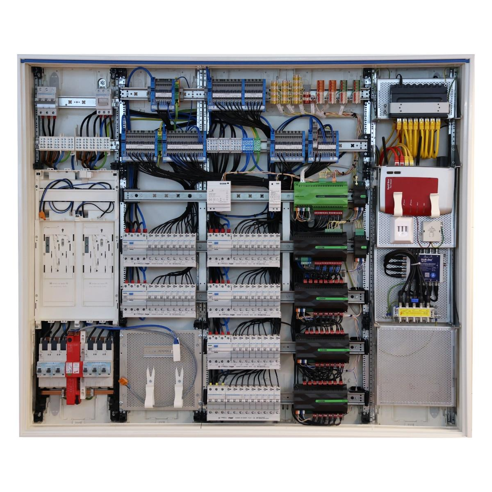

> **Beschreibung:** Foto eines geöffneten, weiß gerahmten Schaltschranks von vorn. Auf mehreren Hutschienen sind Sicherungsautomaten, Reihenklemmen, Netzteile und grüne Busmodule montiert, deren Kabel in blauen, schwarzen und grauen Bündeln verlegt sind. Oben rechts sitzen gelbe Netzwerkkabel und ein rotes Gerät, unten links ein Hauptschalter mit rotem Überspannungsschutz. Das Bild zeigt den strukturierten Aufbau einer Smart-Home-Verteilung im Detail.

---

## Folie 14 — Schicht 2 (Forts.): Aufbau des Schaltschranks (Praxisbeispiel)

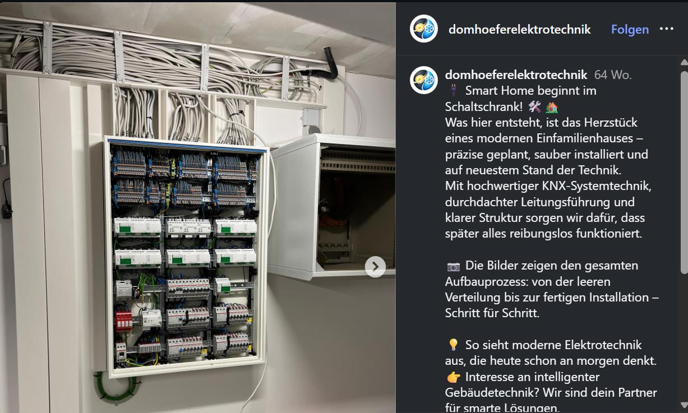

> **Beschreibung:** Screenshot eines Social-Media-Beitrags des Elektrobetriebs domhoeferelektrotechnik, links ein Foto eines in die Wand eingelassenen Schaltschranks mit KNX-Komponenten. Rechts steht der Begleittext, der den Aufbau vom leeren Verteiler bis zur fertigen Installation als Schritt-für-Schritt-Serie ankündigt. Die Abbildung dient als Beleg für eine reale KNX-Installation.

---

## Folie 15 — 3. Die Steuerungsebene: Das Gateway / Hub (Das Gehirn)

Die **Zentrale (auch Gateway, Bridge oder Hub genannt)** ist das Herzstück des Smart Homes. Sie übersetzt die Signale der verschiedenen Geräte und führt die automatischen Logiken aus.

- **Lokale Zentralen:** Systeme wie **Home Assistant** oder **ioBroker** laufen auf eigener Hardware (z. B. einem Raspberry Pi) im Haus. Ihre Daten bleiben lokal und funktionieren oft auch ohne Internet.
- **Cloud-Zentralen:** Systeme wie **Philips Hue Bridge** oder **Bosch Smart Home** senden Daten oft in eine Cloud, bieten dafür aber eine sehr einfache Plug-and-Play-Einrichtung.

---

## Folie 16 — 4. Die Bedienebene: Benutzerschnittstellen (Die Bedienung)

<!-- NEU -->
*Fachliche Korrektur: Im Original hieß diese Schicht „4. Die Unternehmensebene". Der Begriff stammt aus der Automatisierungspyramide (ISA-95) und bezeichnet dort die ERP-/Betriebsleitebene eines Industriebetriebs. Für die Bedienoberfläche im Wohnhaus ist er unpassend — korrekt heißt sie hier **Bedienebene**.*

Hier interagiert der Mensch mit dem System. Das System läuft zwar im Idealfall vollautomatisch, kann aber jederzeit übersteuert werden durch:

- **Apps** auf dem Smartphone oder Tablet.
- **Sprachassistenten** (z. B. Apple Siri, Amazon Alexa, Google Assistant).
- **Klassische Taster** an der Wand, die digital umprogrammiert wurden (z. B. „Ein Klick = Licht an, Doppelklick = Alles aus im Raum").

---

## Folie 17 — Zusammenfassung Teil 1: Ablauf von Smart Home

<!-- NEU -->
*Diese und die folgende Folie wiederholen die vier Schichten. Sie sind die **Zusammenfassung von Teil 1**, kein neuer Inhalt.*

| Stufe | Inhalt |
|---|---|
| 1. Geräte | Sensoren (Messen) & Aktoren (Schalten) |
| 2. Protokoll | Funk (Zigbee, Matter) oder Kabel (KNX) |
| 3. Zentrale | Smart Home Gateway / Hub (die „Zentrale") |
| 4. Steuerung | Smartphone, Sprachassistent, Wandschalter |

<!-- NEU -->
> Stufe 4 heißt in dieser Tabelle „Steuerung" und entspricht der auf Folie 16 korrigierten **Bedienebene**.

---

## Folie 18 — Zusammenfassung Teil 1: Beispiel für den Ablauf

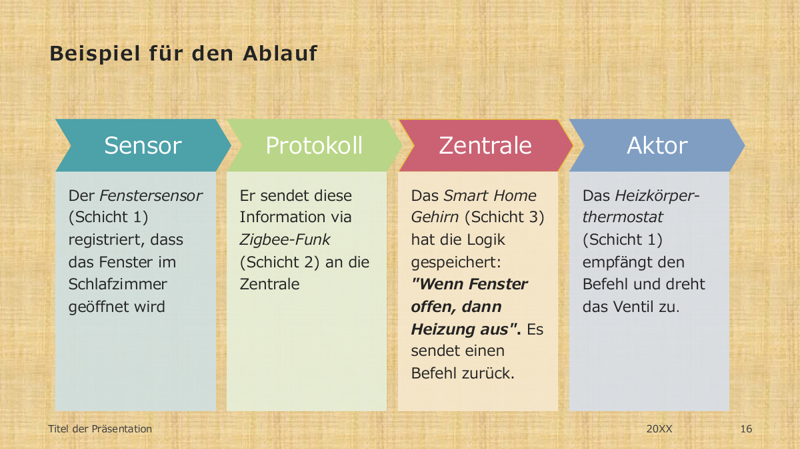

> **Beschreibung:** Vektorgrafik mit vier nebeneinanderliegenden Pfeil-Kacheln in Türkis, Hellgrün, Rot und Blau, beschriftet mit „Sensor", „Protokoll", „Zentrale" und „Aktor". Darunter stehen jeweils erläuternde Textkästen, die einen Fenstersensor, Zigbee-Funk, das Smart-Home-Gehirn und einen Heizkörperthermostat beschreiben. Die Pfeilrichtung von links nach rechts zeigt den Informationsfluss vom Messen über die Übertragung und Logik bis zum Schalten.

| Stufe | Beispiel |
|---|---|
| Sensor (Schicht 1) | Der Fenstersensor registriert, dass das Fenster im Schlafzimmer geöffnet wird. |
| Protokoll (Schicht 2) | Er sendet diese Information via Zigbee-Funk an die Zentrale. |
| Zentrale (Schicht 3) | Das Smart-Home-Gehirn hat die Logik gespeichert: „Wenn Fenster offen, dann Heizung aus". Es sendet einen Befehl zurück. |
| Aktor (Schicht 1) | Das Heizkörperthermostat empfängt den Befehl und dreht das Ventil zu. |

---

# Teil 2 — Exkurs: Wie die Zentrale denkt

<!-- NEU -->
## Folie 19 — Teil 2: Exkurs — Wie die Zentrale denkt

### Teil 2 — Exkurs: Wie die Zentrale denkt

**Für wen ist dieser Teil?** Für alle, die wissen wollen, was auf Schicht 3 (der Zentrale) tatsächlich passiert. Die folgenden fünf Folien zeigen die Logik hinter einer Automatisierung — an einem minimalen Python-Beispiel und am Begriff der Hysterese.

**Dieser Teil ist ein Exkurs.** Wer nur die Systeme und Anbieter vergleichen will, kann direkt zu Teil 3 springen; für das Verständnis von Teil 3 bis 7 ist er nicht zwingend nötig.

*(Kapiteltrennfolie — recycelt aus der funktionslosen Leerfolie F86.)*

---

## Folie 20 — Einfaches Python Script

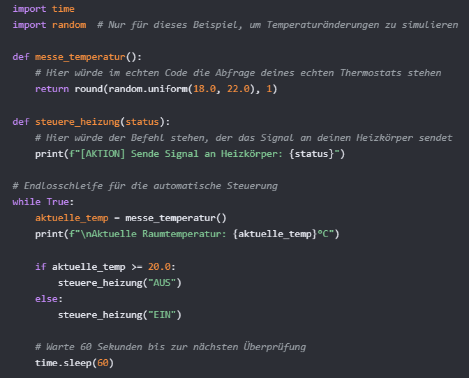

> **Beschreibung:** Screenshot eines Quelltexts in dunklem Editor-Design mit farbiger Syntaxhervorhebung. Das Skript importiert `time` und `random`, definiert `messe_temperatur()` (liefert einen Zufallswert zwischen 18,0 und 22,0 °C) und `steuere_heizung(status)` (gibt ein Signal aus). Eine `while True`-Schleife prüft ab 20,0 °C „AUS", sonst „EIN" und wartet anschließend 60 Sekunden. Die Abbildung zeigt eine minimale, simulierte Steuerungslogik ohne echte Hardware.

---

## Folie 21 — Hysterese

Die **Hysterese** (auch Schalthysterese) bei einer Heizung ist der Temperaturbereich zwischen dem Ein- und Ausschaltpunkt des Wärmeerzeugers.

**Funktionsweise**

**Beispiel:** Ist die Solltemperatur auf **22 °C** eingestellt und die Hysterese beträgt **0,5 °C**:

- Die Heizung **schaltet ein**, wenn die Temperatur auf **21,5 °C** fällt.
- Die Heizung **schaltet ab**, wenn die Temperatur **22,5 °C** erreicht.

**Zweck:** Sie verhindert das ständige, nervige An- und Ausschalten (das sogenannte „Takten" oder „Relais-Rattern") der Heizung bei winzigen Temperaturschwankungen.

<!-- NEU -->
*Hinweis: Das Original verwies hier zweimal auf „[1, 2]". Ein Literaturverzeichnis existiert in der Präsentation nicht, die Marker lösen nirgends auf. Sie sind entfernt; der offene Beleg ist auf der Quellenfolie 107 vermerkt.*

---

## Folie 22 — Einfaches Python Script mit Hysterese

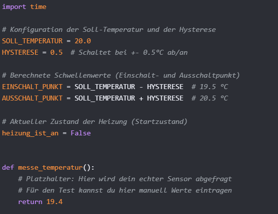

> **Beschreibung:** Screenshot eines Python-Skripts im dunklen Editor-Design mit Syntaxfarben. Oben sind `SOLL_TEMPERATUR = 20.0` und `HYSTERESE = 0.5` konfiguriert, daraus werden `EINSCHALT_PUNKT` (19,5 °C) und `AUSSCHALT_PUNKT` (20,5 °C) berechnet. Der Startzustand `heizung_ist_an` ist `False`, und die Funktion `messe_temperatur()` ist als Platzhalter mit Rückgabewert 19,4 angelegt. Die Abbildung zeigt die Parameter, mit denen die Schaltschwellen festgelegt werden.

---

## Folie 23 — Die Scriptlogik (Python)

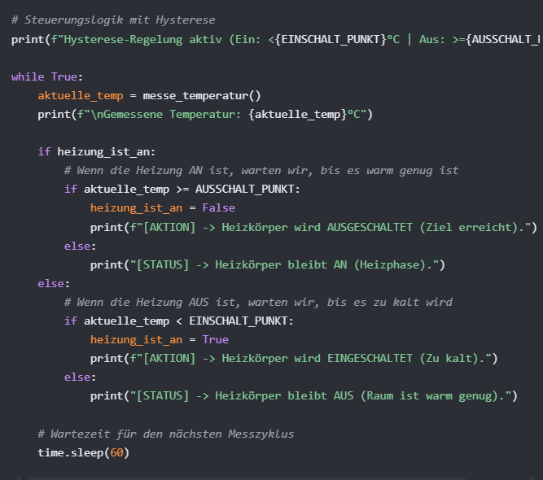

> **Beschreibung:** Screenshot des Python-Quellcodes im dunklen Editor-Design mit farbig hervorgehobenen Schlüsselwörtern und Strings. Die `while True`-Schleife misst die Temperatur und prüft abhängig vom Zustand `heizung_ist_an`: Bei eingeschalteter Heizung wird sie erst ab dem Ausschaltpunkt abgeschaltet, bei ausgeschalteter erst unterhalb des Einschaltpunkts wieder eingeschaltet. Jede Aktion wird mit einer Statusmeldung ausgegeben, und danach wartet das Skript 60 Sekunden.

---

## Folie 24 — Beispiel: Automatisierung „Keller Bad"

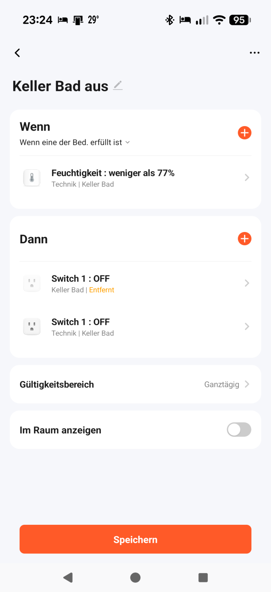

> **Beschreibung:** Zwei Screenshots der Tuya-Smart-App mit der Automatisierungs-Ansicht. Links „Keller Bad an": Wenn eine Bedingung erfüllt ist, Feuchtigkeit größer als 80 %; dann Switch 1 ON für „Keller Bad" (als „Entfernt" markiert) und Switch 1 ON für „Technik | Keller Bad". Rechts „Keller Bad aus": Feuchtigkeit weniger als 77 %; dann Switch 1 OFF für beide Schalter. Gültigkeitsbereich ist „Ganztägig", die Option „Im Raum anzeigen" ist deaktiviert, unten jeweils der orangefarbene Button „Speichern".

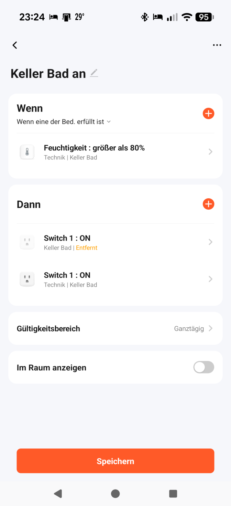

> **Beschreibung:** Zweiter Screenshot derselben Automatisierung, hier als Gegenstück zum Einschalten: Die Bedingung „Feuchtigkeit: weniger als 77 %" schaltet die beiden Schalter „Switch 1" wieder aus. Die Abstufung 80 % (an) und 77 % (aus) bildet eine Hysterese, damit das Gerät nicht bei einem Wert um die Schwelle ständig schaltet. Die Oberfläche entspricht dem Editor der Tuya-App mit Wenn-/Dann-Blöcken.

---

# Teil 3 — Systeme im Vergleich

<!-- NEU -->
## Folie 25 — Teil 3: Systeme im Vergleich

### Teil 3 — Systeme im Vergleich

Drei Systeme, drei Philosophien: **Tuya → Zigbee → Matter**.

*(Kapiteltrennfolie — recycelt aus der funktionslosen Leerfolie F93.)*

---

<!-- NEU -->
## Folie 26 — Vergleichsmatrix: Tuya, Zigbee, Matter

### Die Dramaturgie dieses Teils

Die drei Systeme kommen in einer bewussten Reihenfolge: **von Cloud-abhängig und billig (Tuya) über lokal und sparsam (Zigbee) zu lokal, sparsam und herstelleroffen (Matter)** — schlecht, gut, besser. Wer das im Kopf behält, braucht sich die 16 folgenden Detailfolien nicht zu merken.

### Vergleichsmatrix

| Kriterium | Tuya | Zigbee | Matter |
|---|---|---|---|
| **Lokaler Betrieb** | nein — Steuerung läuft über die Tuya Cloud | ja — Befehle werden direkt im Haus verarbeitet | ja — Steuerung komplett lokal im Heimnetzwerk |
| **Hub / Zentrale nötig** | bei WLAN-Geräten nein; für Zigbee-Geräte ein Tuya-Gateway | ja, zwingend (Bridge oder Zigbee-USB-Stick) | ja — Matter-Controller; für Thread zusätzlich ein Thread Border Router |
| **Cloud-Zwang** | ja — ohne Internet fallen Routinen und Fernsteuerung aus | nein — funktioniert unabhängig vom Internet | nein — keine Cloud-Verbindung für die Schaltung nötig |
| **Herstelleroffen** | nur innerhalb des Tuya-Ökosystems (viele White-Label-Marken, eine Plattform) | teilweise — „Kompatibilitäts-Inseln": Geräte verschiedener Hersteller lassen sich nicht immer an derselben Zentrale anlernen | ja — garantierter Parallelbetrieb mit Apple Home, Google Home, Alexa, SmartThings („Multi-Admin") |
| **Energiebedarf** | hoch — WLAN verbraucht mehr Strom und belastet den Router | sehr niedrig — Batteriesensoren halten oft jahrelang mit einer Knopfzelle | niedrig über Thread, höher über WLAN |
| **Preisniveau** | sehr günstig | günstig | höher — Matter-Hardware ist aktuell meist teurer als Tuya oder reines Zigbee |

> **Herkunft der Werte:** Alle Einträge sind ausschließlich aus den Original-Folien F22–F28 abgeleitet (Vorteile/Nachteile der drei Systeme) — es sind keine zusätzlichen Daten hinzugefügt. Das Preisniveau ergibt sich aus der Aussage auf F28, Matter sei „meist teurer als einfache Tuya- oder reine Zigbee-Komponenten".

---

## Folie 27 — Tuya: Vorteile

**Tuya:** Tuya stellt die Software-Infrastruktur für tausende White-Label-Hersteller (wie Lidl Livarno, Luminea, Nedis) bereit.
Die Steuerung erfolgt meist über die **Tuya Smart** oder **Smart Life App**.

**Vorteile:**

- **Riesige Produktauswahl:** Es gibt extrem viele, sehr günstige Geräte (Leuchtmittel, Stecker, Kameras).
- **Einfacher Einstieg:** Viele Tuya-Geräte nutzen einfaches WLAN – man benötigt oft keine teure separate Zentrale (Bridge/Hub).
- **Gute App-Funktionen:** Die Apps bieten umfangreiche Automatisierungsmöglichkeiten und Szenen.

---

## Folie 28 — Tuya: Nachteile

**Nachteile:**

- **Cloud-Zwang:** Fällt das Internet oder die Tuya-Cloud aus, funktionieren viele Routinen und die Fernsteuerung nicht mehr.
- **Datenschutz:** Da es sich um eine globale Cloud-Plattform handelt, wandern Nutzungsdaten über externe Server.
- **WLAN-Überlastung:** Viele günstige Tuya-WLAN-Geräte können den heimischen Router schnell überlasten.

---

## Folie 29 — Tuya: Die drei Kommunikationswege

**Der Standard-Weg (WLAN-Geräte):**

Smartphone App → *Internet* → **Tuya Cloud** → *Internet/Router* → **Tuya WLAN-Gerät**

**Der Brücken-Weg (Zigbee/Bluetooth-Geräte):**

Smartphone App → *Internet* → **Tuya Cloud** → *Internet* → **Tuya Zigbee Gateway** → *Lokaler Funk* → **Zigbee-Sensor**

**Der Drittanbieter-Weg (Sprachassistenten):**

**Sprachbefehl** („Alexa...") → **Amazon/Google Cloud** → *Cloud-to-Cloud Kopplung* → **Tuya Cloud** → **Endgerät**

---

## Folie 30 — Tuya System-Architektur & Kommunikationswege

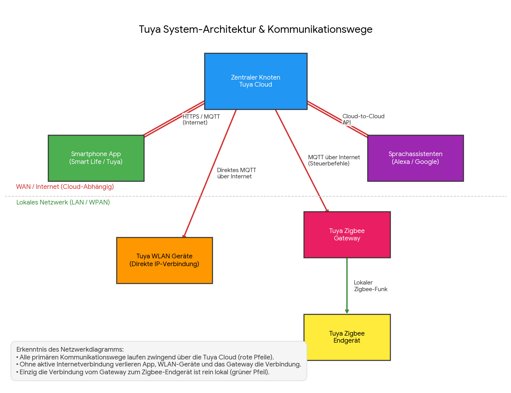

> **Beschreibung:** Netzwerkdiagramm mit Kästen und Pfeilen. Oben in Blau der „Zentrale Knoten Tuya Cloud", darunter links die grüne „Smartphone App (Smart Life / Tuya)", rechts die violette „Sprachassistenten (Alexa / Google)". Alle drei Verbindungen zur Cloud sind rot und doppelt gezeichnet (HTTPS/MQTT bzw. Cloud-to-Cloud API). Eine gestrichelte Linie trennt oben „WAN / Internet (Cloud-Abhängig)" vom unteren Bereich „Lokales Netzwerk (LAN / WPAN)". Darunter die orange „Tuya WLAN Geräte" (direkte IP-Verbindung per MQTT über das Internet) und das pinke „Tuya Zigbee Gateway", das über einen grünen Pfeil „Lokaler Zigbee-Funk" mit dem gelben „Tuya Zigbee Endgerät" verbunden ist.
> Im Kasten unten links steht die Erkenntnis: Alle primären Wege laufen über die Tuya Cloud; ohne Internet verlieren App und WLAN-Geräte die Verbindung; nur Gateway zu Zigbee-Endgerät ist rein lokal.

---

## Folie 31 — Zigbee: Vorteile

Zigbee ist ein etablierter, energiesparender Funkstandard für Smart-Homes, der unter anderem von Philips Hue, IKEA Home smart und Aqara genutzt wird.

**Vorteile:**

- **Lokaler Betrieb:** Befehle werden direkt im Haus verarbeitet. Das System funktioniert extrem schnell und ist komplett unabhängig vom Internet.
- **Mesh-Netzwerk:** Jedes dauerhaft am Strom hängende Zigbee-Gerät (z. B. eine Lampe) wirkt als Signalverstärker. Das erhöht die Reichweite enorm.
- **Extrem energiesparend:** Batteriebetriebene Sensoren und Schalter halten oft jahrelang mit einer Knopfzelle.

---

## Folie 32 — Zigbee: Nachteile

**Nachteile:**

- **Hub/Zentrale erforderlich:** Man benötigt zwingend ein Gateway (z. B. Philips Hue Bridge oder einen universellen Zigbee-USB-Stick).
- **Kompatibilitäts-Inseln:** Obwohl alle „Zigbee" nutzen, lassen sich Geräte verschiedener Hersteller nicht immer ohne Weiteres an derselben Zentrale anlernen.

---

## Folie 33 — Zigbee-Architektur & Lokaler Kommunikationsgraph

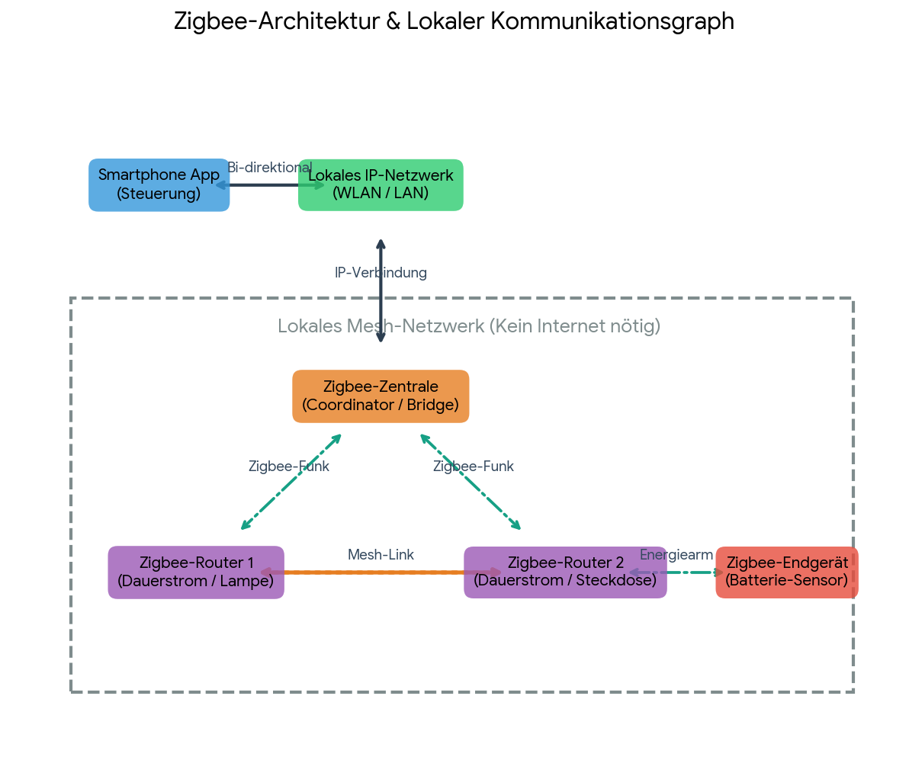

> **Beschreibung:** Netzwerkdiagramm mit farbigen Rechtecken und Pfeilen. Oben verbinden eine blaue Smartphone-App (Steuerung) und ein grünes lokales IP-Netzwerk (WLAN/LAN) bidirektional sowie per IP-Verbindung mit einer orangen Zigbee-Zentrale (Coordinator / Bridge). Darunter liegt ein gestricheltes Rechteck „Lokales Mesh-Netzwerk (Kein Internet nötig)“, in dem die Zentrale per grünen Zigbee-Funk-Pfeilen mit zwei violetten Routern verbunden ist: Router 1 (Dauerstrom / Lampe) und Router 2 (Dauerstrom / Steckdose). Zwischen beiden Routern zeigt eine orange Linie den „Mesh-Link“, und ein Pfeil „Energiearm“ führt zum roten Zigbee-Endgerät (Batterie-Sensor).

---

## Folie 34 — Matter

Matter ist der neueste, vom Branchenkonsortium (Apple, Google, Amazon, Samsung u. a.) entwickelte Standard. Er soll die Fragmentierung des Smart-Homes endgültig beenden. Matter nutzt als Transportwege bestehendes WLAN oder das moderne, energiesparende **Thread**-Funknetzwerk.

---

## Folie 35 — Matter: Vorteile

**Vorteile:**

- **Herstellerübergreifend:** Ein Matter-Gerät funktioniert garantiert mit Apple Home, Google Home, Amazon Alexa und Samsung SmartThings gleichzeitig („Multi-Admin").
- **Zukunftssicher und lokal:** Matter steuert Geräte komplett lokal im Heimnetzwerk – für maximale Geschwindigkeit und Ausfallsicherheit ohne Cloud-Zwang.
- **Hohe Sicherheit:** Der Standard setzt auf moderne Verschlüsselungs- und Sicherheitsmechanismen bei der Geräte-Inbetriebnahme.

---

## Folie 36 — Matter: Nachteile

**Nachteile:**

- **Noch in der Entwicklung:** Der Standard deckt noch nicht alle Geräteklassen (z. B. komplexe Kameras oder Spezial-Sensoren) perfekt ab. Updates der Hersteller verzögern sich oft.
- **Hardware-Anforderungen:** Für Thread-basierte Matter-Geräte wird ein kompatibler „Thread Border Router" benötigt (z. B. ein neuerer Apple HomePod, Google Nest Hub oder Amazon Echo).
- **Höherer Preis:** Matter-zertifizierte Hardware ist aktuell meist teurer als einfache Tuya- oder reine Zigbee-Komponenten.

---

## Folie 37 — Der Matter-Controller (Die Steuerzentrale)

**Der Matter-Controller (Die Steuerzentrale):**

**Funktion:** Das Gehirn, das die Geräte steuert, Automatisierungen ausführt und die Schnittstelle zu deiner App bildet. Beispiele sind ein Apple TV 4K, ein Google Nest Hub oder ein Amazon Echo.

**Besonderheit („Multi-Admin“):** Ein Matter-Netzwerk kann **mehrere Controller gleichzeitig** haben. Du kannst ein und dieselbe Matter-Lampe parallel über Apple Home (auf dem iPad) und Google Home (auf einem Android-Tablet) steuern. Die Controller synchronisieren den Gerätestatus direkt lokal untereinander.

---

## Folie 38 — Der Thread Border Router (Die Funk-Brücke)

**Der Thread Border Router (Die Funk-Brücke):**

**Funktion:** Viele moderne, kleine Matter-Geräte funken nicht über das stromhungrige WLAN, sondern über das effiziente **Thread**-Funknetzwerk. Der *Thread Border Router* verbindet das Thread-Netzwerk nahtlos mit deinem normalen Heimnetzwerk (WLAN/LAN). Oft ist diese Funktion direkt in den Matter-Controller (z. B. im Apple TV oder Nest Hub) eingebaut.

---

## Folie 39 — Die Matter-Endgeräte (WLAN oder Thread)

**Die Matter-Endgeräte (WLAN oder Thread):**

**Matter-über-WLAN:** Größere Geräte, die viel Strom verbrauchen oder permanent am Netz hängen (z. B. smarte Steckdosen, smarte Haushaltsgeräte), nutzen dein normales WLAN. Sie sprechen Matter direkt über deinen Router.

**Matter-über-Thread (Router & Endpoints):** Stromsparende Geräte (Lampen, Sensoren) bauen untereinander ein stabiles **Thread-Mesh-Netzwerk** auf – ähnlich wie bei Zigbee. Lampen leiten Signale weiter (Router), während Batterie-Sensoren nur senden, wenn sich etwas ändert (Endpoints).

---

## Folie 40 — Ablauf eines typischen Schaltbefehls

Da Matter auf der gleichen IP-Technologie (Internet Protocol) wie dein Computer oder Smartphone basiert, sprechen alle Geräte „dieselbe Sprache“ – egal ob sie per Kabel, WLAN oder Thread verbunden sind. Ein typischer Schaltbefehl läuft so ab:

**Smartphone App (z. B. Apple Home)**

→ *(Lokales WLAN)* → **Matter Controller / Thread Border Router** → *(Lokaler Thread-Funk)* → **Thread-Router (Lampe im Wohnzimmer)** → *(Lokaler Thread-Funk)* → **Matter-Heizkörperthermostat**

---

## Folie 41 — Lokal vs. Cloud: Der entscheidende Vorteil

<!-- NEU -->
*Diese Folie fasst die beiden nahezu identischen Original-Folien F31 („Der entscheidende Vorteil: lokale Datenverarbeitung", zu Zigbee) und F37 („Der entscheidende Vorteil: lokale Kommunikation", zu Matter) zusammen. Beide Originaltexte sind unten wörtlich erhalten.*

**Zigbee (F31):** Der entscheidende Vorteil: Dieser gesamte Datenverkehr verlässt niemals dein Haus. Selbst wenn dein Internetanbieter eine Störung hat oder dein Router komplett vom Strom getrennt wird, funktioniert dieser Funkgraph autark weiter.

**Matter (F37):** Der entscheidende Vorteil: Wie bei Zigbee bleibt die gesamte Kommunikation **zu 100 % lokal** in deinem Haus. Es ist keine Cloud-Verbindung für die Schaltung notwendig. Gleichzeitig entfällt das Problem von Zigbee, dass Geräte verschiedener Hersteller (z. B. Hue und Aqara) separate Bridges benötigen – bei Matter fließen alle Daten nahtlos durch dieselbe lokale Netzwerkstruktur.

<!-- NEU -->
**Und Tuya?** Genau umgekehrt: Alle primären Wege laufen über die Tuya Cloud (siehe Folie 29/30). Ohne Internet verlieren App und WLAN-Geräte die Verbindung. Das ist der Übergang zu Teil 4.

---

<!-- NEU -->
## Folie 42 — Abschluss Teil 3: Die Vergleichsmatrix

| Kriterium | Tuya | Zigbee | Matter |
|---|---|---|---|
| **Lokaler Betrieb** | nein | ja | ja |
| **Hub / Zentrale nötig** | nur für Zigbee-Geräte | ja, zwingend | ja (Controller, + Border Router für Thread) |
| **Cloud-Zwang** | ja | nein | nein |
| **Herstelleroffen** | nein (Tuya-Ökosystem) | teilweise (Kompatibilitäts-Inseln) | ja (Multi-Admin) |
| **Energiebedarf** | hoch (WLAN) | sehr niedrig | niedrig (Thread) / höher (WLAN) |
| **Preisniveau** | sehr günstig | günstig | höher |

**Merksatz:** Je weiter rechts, desto unabhängiger vom Internet und vom Hersteller — und desto teurer in der Anschaffung.

> Werte identisch zur Einstiegsmatrix auf Folie 26; dort steht die ausführliche Begründung und die Herkunft jedes Eintrags.

---

# Teil 4 — Risiken

<!-- NEU -->
## Folie 43 — Teil 4: Risiken

### Teil 4 — Risiken

Vier Risikoebenen, die bei der Systemwahl zusammen betrachtet werden müssen:

1. **Cloud-Abhängigkeit & Datenschutz** — wohin gehen die Daten?
2. **IT-Sicherheit** — wer kommt von außen rein?
3. **Lebensdauer** — was passiert, wenn der Hersteller abschaltet?

*(Kapiteltrennfolie — recycelt aus der funktionslosen Leerfolie F95.)*

---

## Folie 44 — Gefahren und Fallstricke von Cloudanbietern

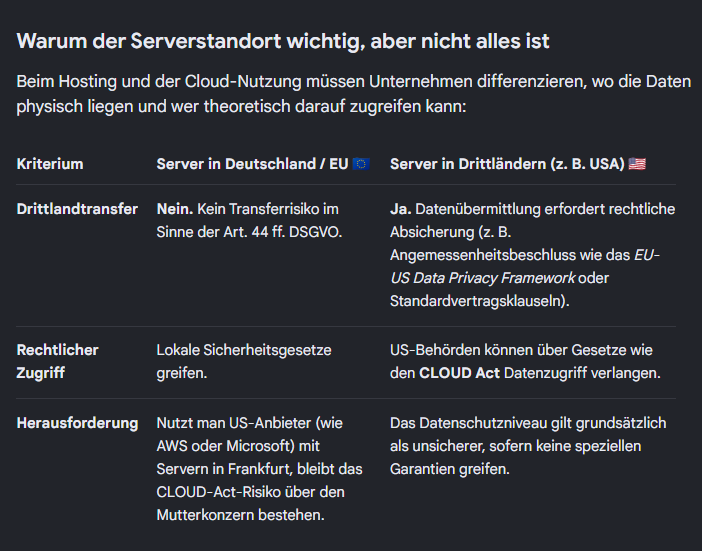

> **Beschreibung:** Screenshot einer dunklen Tabelle mit dem Titel „Warum der Serverstandort wichtig, aber nicht alles ist“. Die Tabelle vergleicht die Kriterien „Drittlandtransfer“, „Rechtlicher Zugriff“ und „Herausforderung“ für Server in Deutschland/EU und Server in Drittländern (z. B. USA). Für Deutschland/EU steht dort „Nein“ bzw. kein Transferrisiko im Sinne der Art. 44 ff. DSGVO, für Drittländer „Ja“ mit Absicherungspflicht (z. B. EU-US Data Privacy Framework oder Standardvertragsklauseln). Beim Hosting bei US-Anbietern mit Servern in Frankfurt bleibt laut Tabelle das CLOUD-Act-Risiko über den Mutterkonzern bestehen.

---

## Folie 45 — Drittland-Risiko am Beispiel China

<!-- NEU -->
*Diese Folie verdichtet die Original-Folien F39, F40, F41 und F42. Die vollständigen Originaltexte stehen wörtlich im Anhang „Gestrichenes Material".*

Das Hosten von personenbezogenen Daten auf einem Server in China ist nach der DSGVO **rechtlich extrem riskant** und in den allermeisten Fällen **unzulässig**.

- **1) Kein Angemessenheitsbeschluss:** Die Europäische Kommission stuft das Datenschutzniveau in China nicht als gleichwertig mit dem europäischen Standard ein.
- **2) Zugriffsrisiko durch Behörden (Geheimdienstgesetz):** Artikel 7 des chinesischen Geheimdienstgesetzes verpflichtet dortige Organisationen und Unternehmen zur Kooperation mit den staatlichen Sicherheitsbehörden. Ein wirksamer Schutz vor staatlichem Zugriff ist damit kaum zu garantieren.
- **3) Scheitern von Standardvertragsklauseln (SCCs):** Im Rahmen des zwingend erforderlichen *Transfer Impact Assessments (TIA)* muss geprüft werden, ob das Recht des Drittlandes die Einhaltung der SCCs aushebelt. Wegen der chinesischen Überwachungsgesetze kommen deutsche Aufsichtsbehörden hier fast immer zu einem negativen Ergebnis.

<!-- NEU -->
> **Belegstatus:** Die drei Punkte sind der Formulierung des Originals entnommen und hier nicht verschärft. Es handelt sich um Rechtsaussagen ohne Quellenangabe in der Präsentation (Angemessenheitsbeschluss, Art. 7 chin. Geheimdienstgesetz, TIA-Pflicht). Sie sind auf der Quellenfolie 107 als **zu belegen** vermerkt und sollten vor dem Vortrag durch eine zitierfähige Quelle gestützt oder abgeschwächt werden.

**Bezug zum Smart Home:** Tuya ist eine globale Cloud-Plattform (siehe Folie 28: „wandern Nutzungsdaten über externe Server"). Genau hier wird die Frage des Serverstandorts praktisch relevant.

---

<!-- NEU -->
## Folie 46 — Leitfrage: Welche Daten verlassen das Haus?

### Drei Fragen, die jedes System beantworten muss

1. **Welche Daten verlassen das Haus?**
2. **Wohin gehen sie?**
3. **Wer darf darauf zugreifen?**

### Welche Daten in diesem Vortrag überhaupt vorkommen

| Datenart | Wo im Vortrag zu sehen | Verrät im Klartext |
|---|---|---|
| Temperatur & Luftfeuchtigkeit pro Raum | Folie 24 (Tuya-Automatisierung), Folie 60/64 (Heizung, tado°) | welche Räume genutzt werden |
| Schaltvorgänge von Licht und Steckdosen | Folie 57/58 (Xiaomi, Google Home) | Tagesrhythmus, Aufstehen, Zubettgehen |
| Fenster- und Türkontakte | Folie 8, Folie 18, Folie 100 | wann niemand zu Hause ist |
| Anwesenheit / Geofencing | Folie 64 (tado° „HOME Geofencing") | Standort der Bewohner |
| Energieverbrauch über Monate | Folie 61/62 (Energiemonitoring) | Urlaubszeiten, Haushaltsgröße |
| Kamerabilder vom Hauseingang | Folie 65 | Gesichter, Besucher, Nachbarn |

**Die Antwort hängt allein an der Architektur, nicht am Marketing:** Läuft die Schaltung lokal (Zigbee, Matter, Home Assistant), verlassen diese Daten das Haus gar nicht. Läuft sie über eine Cloud (Tuya, Xiaomi, Google), verlassen sie es bei jedem Schaltvorgang.

> **Praxis-Hinweis:** Bei Kameras ist zusätzlich zu beachten, dass regelmäßig auch Dritte (Besucher, Nachbarn, Postboten) erfasst werden. Das ist keine neue Rechtsaussage dieses Vortrags, sondern der Punkt, an dem die Verantwortung des Betreibers beginnt — vor dem Vortrag mit einer belastbaren Quelle unterfüttern.

---

<!-- NEU -->
## Folie 47 — IT-Sicherheit: die zweite Risikoebene

Datenschutz fragt: *Wer darf die Daten sehen?* IT-Sicherheit fragt: *Wer kommt ungefragt rein?* Der Vortrag behandelte bisher nur die erste Frage.

### Die drei häufigsten Einfallstore im Heimnetz

- **Offene Ports / Portweiterleitung:** Wer die Kamera oder das Dashboard „von unterwegs" erreichbar machen will und dafür im Router einen Port nach außen öffnet, stellt das Gerät dem gesamten Internet zur Verfügung. Suchmaschinen für offene Geräte finden solche Ports binnen Stunden. Richtiger Weg: VPN ins Heimnetz oder der Reverse-Proxy des Herstellers — keine direkte Portweiterleitung.
- **Fehlende Firmware-Updates:** Billiggeräte erhalten oft nur wenige Monate Updates, manche nie. Eine bekannte Lücke in einem Gerät, das nie wieder ein Update sieht, bleibt für die gesamte Nutzungsdauer offen. Vor dem Kauf prüfen: Gibt es eine Update-Zusage, und wie lange?
- **Botnetze aus Billigkameras:** Unsichere Kameras und Rekorder mit Standardpasswörtern werden massenhaft gekapert und für Angriffe missbraucht. Das Gerät funktioniert dabei äußerlich normal weiter — der Betreiber merkt nichts. Gegenmittel: Standardpasswörter sofort ändern, Geräte in ein eigenes Netzsegment (Gäste-WLAN / VLAN) legen, Internetzugang für Geräte sperren, die ihn nicht brauchen.

### Warum das in diesen Vortrag gehört

Jedes Argument für lokale Systeme aus Teil 3 wirkt doppelt: Ein Gerät, das keine Cloud braucht, braucht auch keinen offenen Port.

> **Belegstatus:** Allgemein anerkannte Sicherheitsgrundsätze, hier ohne Zitat. Für den Vortrag mit einer belastbaren Quelle (z. B. BSI-Empfehlungen zu Smart Home) unterfüttern — auf der Quellenfolie 107 vermerkt.

---

<!-- NEU -->
## Folie 48 — Lebensdauer-Risiko: wenn der Hersteller abschaltet

Folie 28 nennt den Cloud-**Ausfall** bei Tuya: „Fällt das Internet oder die Tuya-Cloud aus, funktionieren viele Routinen und die Fernsteuerung nicht mehr." Das ist der harmlose Fall — er ist vorübergehend.

### Der Härtefall: die Cloud wird abgeschaltet

Ein cloud-gebundenes Gerät ist nur so lange ein Gerät, wie der Hersteller den Server bezahlt. Wird der Dienst eingestellt — Insolvenz, Produktende, Strategiewechsel, Übernahme —, dann:

- lässt sich das Gerät **nicht mehr einrichten**, auch nicht lokal,
- fällt die App aus, und mit ihr **jede Automatisierung**,
- bleibt physisch intakte Hardware zurück, die **nichts mehr tut** — Elektroschrank statt Elektronik.

Kein Update, kein Workaround, keine Garantie greift. Die Geräte sind nicht defekt, sie sind verwaist.

### Warum das das stärkste Argument für lokale Systeme ist

| | Cloud-gebunden | Lokal (Zigbee, Matter, KNX, Home Assistant) |
|---|---|---|
| Hersteller stellt Dienst ein | Gerät wird unbrauchbar | Gerät funktioniert weiter |
| Internet fällt aus | Steuerung fällt aus | Steuerung läuft weiter |
| Investitionsschutz | an die Lebensdauer eines Serverbetriebs gebunden | an die Lebensdauer der Hardware gebunden |

**Für den Entscheider:** Bei KNX wird in Jahrzehnten gerechnet (siehe Folie 80: „hält jahrzehntelang"). Bei einer Cloud-Plattform rechnet niemand in Jahrzehnten. Wer eine Immobilie ausstattet, trifft damit keine Produkt-, sondern eine Zeithorizont-Entscheidung.

> **Belegstatus:** Der Mechanismus ist aus der Architektur der auf Folie 29/30 gezeigten Kommunikationswege zwingend ableitbar. Konkrete Abschaltfälle sind hier bewusst **nicht** benannt, weil die Präsentation keine nennt — für den Vortrag ein belegtes Beispiel ergänzen (Quellenfolie 107).

---

# Teil 5 — Anbieter

<!-- NEU -->
## Folie 49 — Teil 5: Anbieter

### Teil 5 — Anbieter

Drei Blöcke, bewusst getrennt:

- **Block A — DSGVO-konform:** deutsche Anbieter, Daten bleiben im EU-Rechtsraum.
- **Block B — Verbreitet, aber Cloud:** die Systeme, die faktisch im Einsatz sind.
- **Block C — Praxis-Screenshots:** was im Betrieb tatsächlich zu sehen ist.

Danach: **Home Assistant** als herstellerunabhängige Zentrale, die beide Welten zusammenführt.

*(Kapiteltrennfolie — recycelt aus der funktionslosen Leerfolie F96.)*

---

## Folie 50 — Gibt es deutsche Anbieter?

*Gibt es deutsche Anbieter?*

**KLAR!**

---

## Folie 51 — Block A — DSGVO-konform: der Vorteil

<!-- NEU -->
*Im Original (F47) bestand diese Folie nur aus dem Wort „Vorteil:" und dem Siegel. Der Satz ist hier ausformuliert.*

**Vorteil:**

> **Beschreibung:** Rundes Siegel mit dunkelblauem Außenring, auf dem zwölf gelbe Sterne im Kreis angeordnet sind (EU-Symbolik). Im hellen, silbrig glänzenden Innenkreis steht in großer dunkelblauer Schrift „DSGVO“, darunter in gesperrtem Großbuchstabensatz „KONFORM“. Die Grafik ist ein reines Logo-/Badge-Motiv und soll die DSGVO-Konformität des Anbieters als Vorteil visualisieren.

<!-- NEU -->
**Der Vorteil eines Anbieters im EU-Rechtsraum:** Die Daten bleiben im Geltungsbereich der DSGVO — es entsteht kein Drittlandtransfer im Sinne der Art. 44 ff. DSGVO und damit auch keine Absicherungspflicht über Standardvertragsklauseln oder Angemessenheitsbeschluss (siehe Folie 44 und 45). Praktisch heißt das: ein Ansprechpartner im Inland, ein durchsetzbares Auskunfts- und Löschrecht und eine Aufsichtsbehörde, die zuständig ist.

> Diese Zusammenfassung ist aus der Tabelle auf Folie 44 abgeleitet und enthält keine über das Original hinausgehende Rechtsaussage.

---

## Folie 52 — Block A — Smart-Home-Systeme deutscher Anbieter

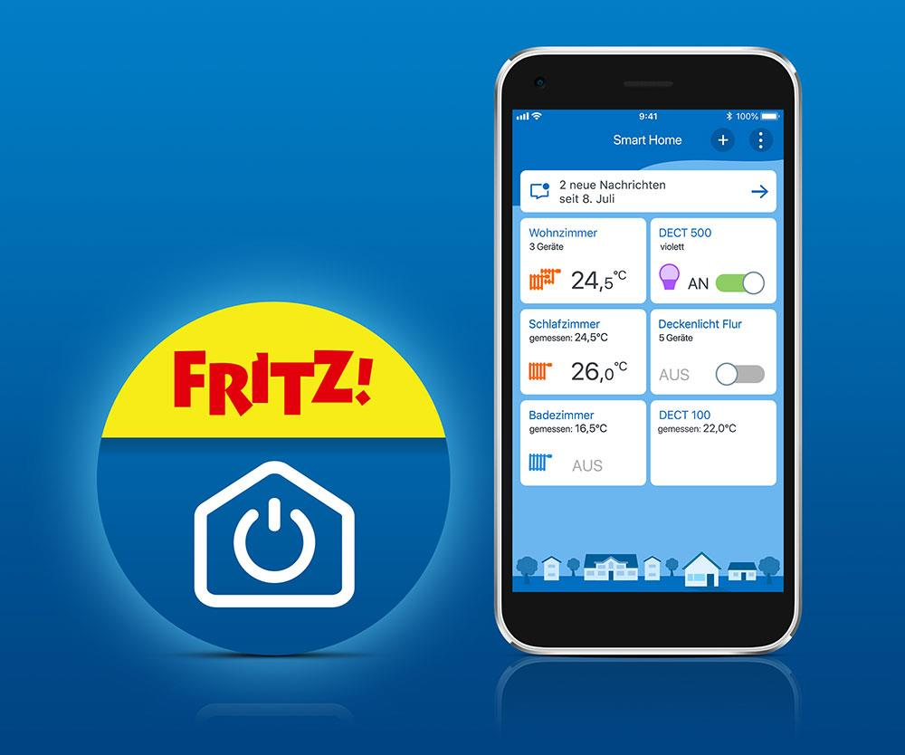

> **Beschreibung:** Blauer Hintergrund mit gelb-rotem FRITZ!-Logo auf einem Kreis mit Hausschalter-Symbol links. Rechts ist ein Smartphone mit der Oberfläche „Smart Home“ zu sehen, die Raumkacheln wie Wohnzimmer (24,5 °C), Schlafzimmer (26,0 °C) und Deckenlicht Flur (AUS) sowie DECT-Steckdosen zeigt. Die Abbildung steht für das Smart-Home-System AVM FRITZ!.

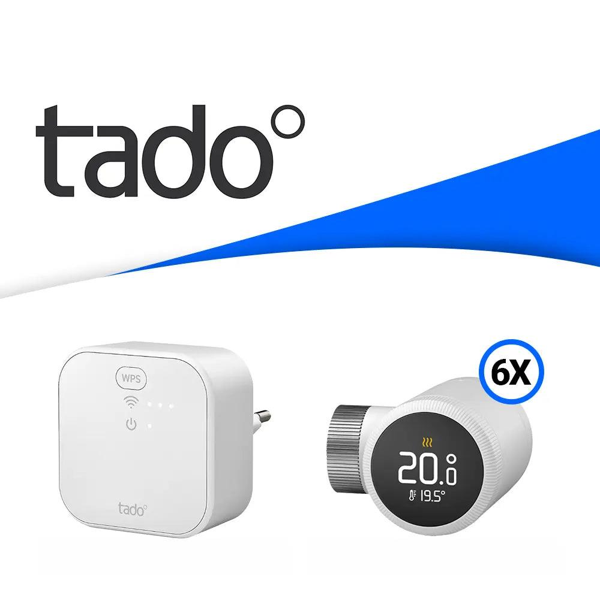

> **Beschreibung:** Produktbild mit weißem tado°-Logo auf weißem Grund und blauem Keil. Zu sehen sind eine weiße quadratische Bridge mit WPS-Taste, die in die Steckdose gesteckt wird, sowie ein Heizkörperthermostat-Kopf mit Display, das 20,0° und 19,5° anzeigt. Die Markierung „6X“ weist auf ein Set mit sechs Thermostaten hin.

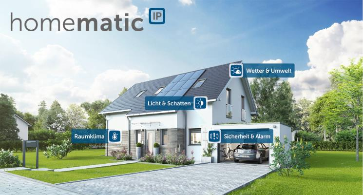

> **Beschreibung:** Fotorealistische Darstellung eines Einfamilienhauses mit Solaranlage, Garage und Garten, dessen Bereiche über blaue Beschriftungsfelder markiert sind. Die Felder lauten „Raumklima“, „Licht & Schatten“, „Wetter & Umwelt“ und „Sicherheit & Alarm“, jeweils mit einem kleinen Symbol. Das Bild zeigt, welche Funktionsbereiche das System Homematic IP abdeckt.

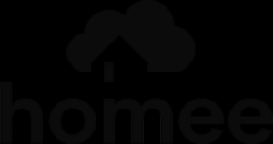

> **Beschreibung:** Schwarzes Logo mit stilisiertem Wolken-und-Dach-Symbol über dem Schriftzug „homee“ in Kleinbuchstaben. Die Grafik ist ein reines Markenlogo ohne weitere Elemente. Sie steht für den Smart-Home-Anbieter homee.

---

## Folie 53 — Block A — Wichtiger deutscher Anbieter: wibutler

Einer der für uns wichtigsten deutschen Anbieter:

> **Beschreibung:** Schwarzes Logo mit stilisiertem Doppel-Dreieck-Symbol (Schleife) links und dem Schriftzug „wibutler“ rechts, auf neutralem Hintergrund. Die Abbildung ist ein reines Markenlogo ohne Daten oder Achsen. Sie kennzeichnet den Anbieter wibutler als einen der wichtigsten deutschen Partner.

---

## Folie 54 — Block A — Partner von wibutler

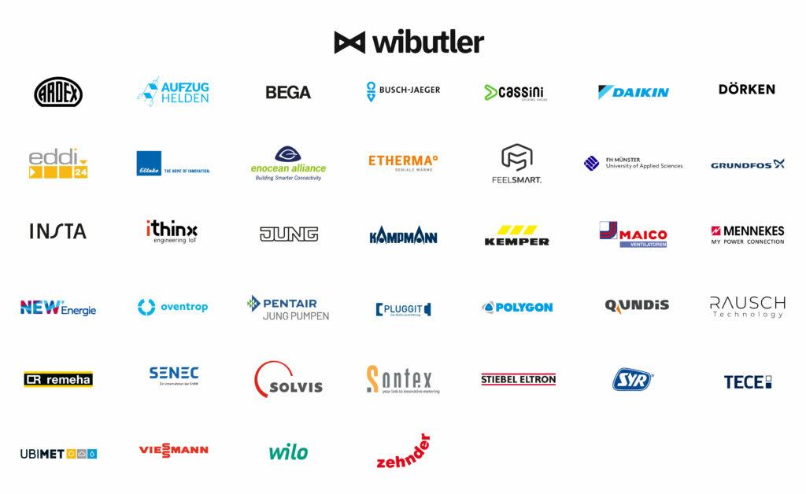

> **Beschreibung:** Weißes Raster mit oben mittig dem wibutler-Logo und darunter etwa 40 Herstellerlogos in sieben Spalten und fünf Reihen. Zu den erkennbaren Marken gehören unter anderem Daikin, Busch-Jaeger, Grundfos, Kemper, Viessmann, Zehnder, Solvis, Tece und Wilo. Die Übersicht zeigt das Partnernetzwerk von wibutler im Bereich Gebäudetechnik und Smart Home.

---

## Folie 55 — Block A — Bosch Smart Home

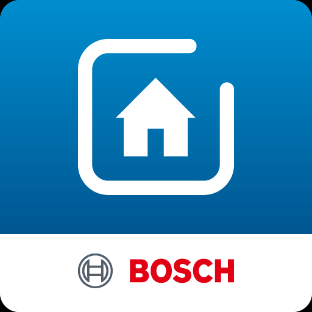

> **Beschreibung:** Quadratisches App-Icon mit blauem Verlauf (heller oben, dunkler unten) und einem weißen, abgerundeten Rahmensymbol mit Haus-Piktogramm. Im unteren weißen Feld steht das rote BOSCH-Logo neben einem grauen Bosch-Kreiszeichen. Das Bild dient als Titelmotiv der Smart-Home-Lösung und enthält keine Daten.

<!-- NEU -->
> **Einordnung:** Bosch Smart Home gehört zu den deutschen Anbietern, arbeitet aber nach Folie 15 cloud-gestützt („Cloud-Zentralen: Systeme wie Philips Hue Bridge oder Bosch Smart Home senden Daten oft in eine Cloud"). Deutscher Anbieter und Cloud-Betrieb sind also keine Gegensätze — entscheidend ist, in welchem Rechtsraum die Cloud betrieben wird. Das ist der Übergang zu Block B.

---

<!-- NEU -->
## Folie 56 — Block B — Verbreitet, aber Cloud: was das bedeutet

### Die Spannung offen benannt

Teil 4 hat Cloud-Plattformen in Drittländern als Datenschutzproblem aufgebaut. Die beiden folgenden Systeme — **Xiaomi Home** und **Google Home** — sind genau dieser Fall: keine deutschen Anbieter, keine lokale Steuerung, Betrieb über Konzern-Clouds außerhalb des deutschen Rechtsraums.

**Warum stehen sie dann im Vortrag?** Weil sie real im Einsatz sind. Die Screenshots auf den nächsten Folien stammen aus einem laufenden Haushalt. Es wäre unredlich, in Teil 4 die Cloud zu problematisieren und dann zu verschweigen, dass die eigene Installation sie nutzt.

### Was man dafür bekommt und was es kostet

| | Block A (DSGVO-konform) | Block B (Cloud, Drittland) |
|---|---|---|
| Einrichtung | aufwendiger, oft Fachbetrieb | Plug-and-play, App-Login |
| Gerätepreis | höher | sehr günstig, riesige Auswahl |
| Daten | bleiben im EU-Rechtsraum | verlassen den EU-Rechtsraum |
| Funktion ohne Internet | je nach System möglich | fällt aus |
| Lebensdauer | an die Hardware gebunden | an den Serverbetrieb gebunden (Folie 48) |

**Die ehrliche Antwort auf den Widerspruch:** Es ist eine Abwägung, keine Richtig-Falsch-Frage. Wer sie bewusst trifft, kann Cloud-Geräte einsetzen — etwa für unkritische Funktionen wie Stehlampen. Wer Kamera, Türschloss und Anwesenheitsdaten in dieselbe Cloud legt, trifft eine andere Entscheidung, als er glaubt. Teil 7 greift das als Entscheidungshilfe wieder auf.

---

## Folie 57 — Block B — Xiaomi Home App

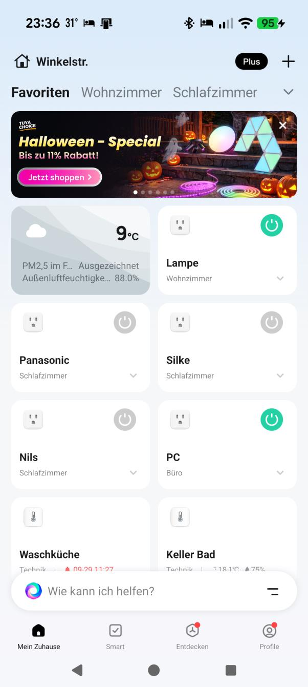

> **Beschreibung:** Screenshot der Startseite der Xiaomi-Home-App im Hochformat mit Reitern Favoriten, Wohnzimmer und Schlafzimmer. Die Kachelansicht zeigt eine Wetterkachel (9 °C, Luftqualität "Ausgezeichnet") sowie Schalter für Lampe, Panasonic, Silke, Nils, PC und Waschküche, aktive Schalter sind grün markiert. Oben steht ein Halloween-Werbebanner.

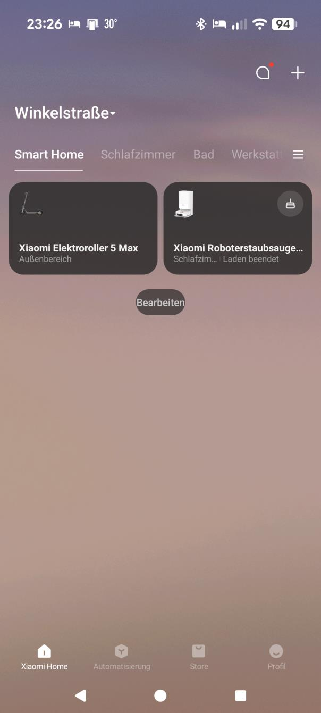

> **Beschreibung:** Screenshot der Geräteliste "Winkelstraße" mit zwei Kacheln: Xiaomi Elektrorollladen 5 Max (Außenbereich) und Xiaomi Roboterstaubsauger (Schlafzimmer, "Laden beendet"). Unten sitzt die Navigationsleiste mit den Punkten Xiaomi Home, Automatisierung, Store und Profil. Die Oberfläche ist dunkel gehalten.

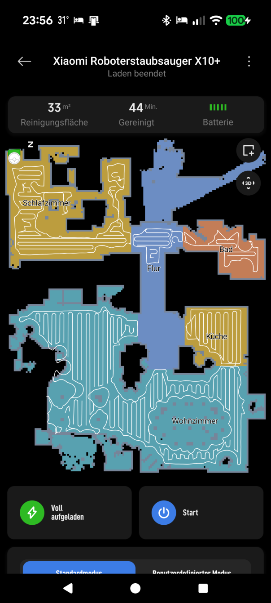

> **Beschreibung:** Screenshot der Statusansicht des Roboterstaubsaugers X10+ mit Reinigungskarte der Wohnung in farbigen Raumbereichen (Blau, Gelb, Orange, Türkis) und weißen Fahrlinien. Oben stehen die Werte Reinigungsfläche 33 m², Reinigungsdauer 44 Min. und ein Batteriebalken, darunter die Schaltflächen "Voll aufladen" und "Start". Der Hintergrund ist schwarz.

<!-- NEU -->
> **Zur Einordnung passend zu Folie 46:** Der dritte Screenshot zeigt einen vollständigen Grundriss der Wohnung. Das ist ein Beispiel dafür, welche Datenart ein Cloud-Gerät nebenbei erzeugt.

---

## Folie 58 — Block B — Google Home

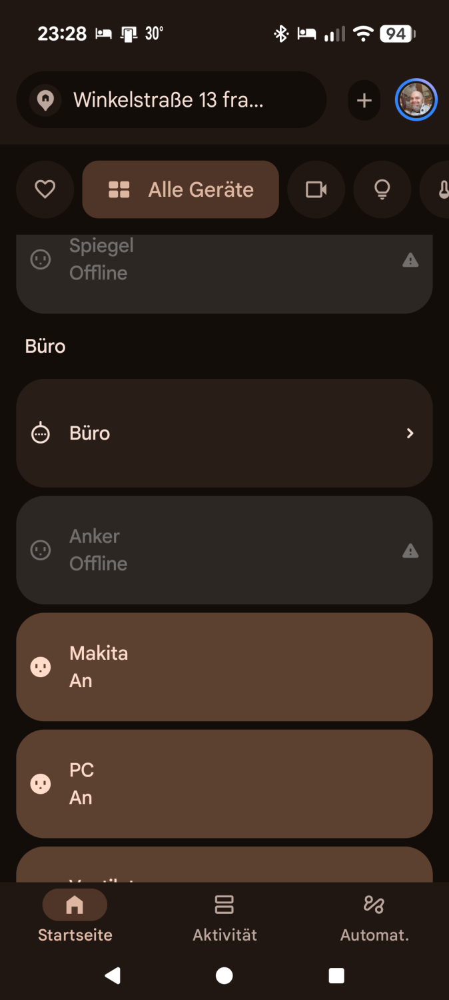

> **Beschreibung:** Screenshot der dunklen Google-Home-Startseite mit braunen Gerätekacheln für Büro, Makita (an), PC (an) sowie als offline markierte Geräte Spiegel und Anker. Unten befindet sich die Navigation mit Startseite, Aktivität und Automat. Offline-Geräte sind grau und mit Warnsymbol dargestellt.

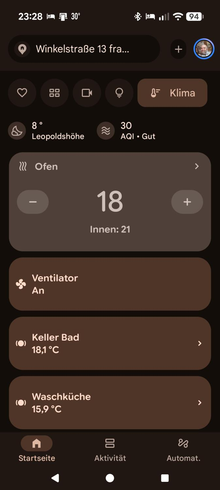

> **Beschreibung:** Screenshot der Klimaansicht mit Ofen-Regler (Soll 18, Innen 21) sowie den Kacheln Ventilator (an), Keller Bad (18,1 °C) und Waschküche (15,9 °C). Oben werden 8 °C für Leopoldshöhe und ein Luftqualitätswert von 30 (AQI "Gut") angezeigt. Der Stil ist durchgehend braun-dunkel.

---

<!-- NEU -->
## Folie 59 — Block C — Praxis-Screenshots aus dem Betrieb

Die folgenden sechs Folien zeigen Oberflächen aus einer laufenden Installation. Sie sind **bewusst als eigener Block** zusammengefasst, weil sich im Original keine saubere Anbieterzuordnung aus den Folien selbst ergibt.

Soweit erkennbar:

| Folien | Was zu sehen ist | Erkennbare Zuordnung |
|---|---|---|
| 60–63 | Heizkreis, Zeitprogramm, Energiemonitoring, Anlagen-Monitoring eines Gas-Brennwertgeräts | Bosch-Heizungs-App (aus dem Bildinhalt abgeleitet, siehe Folie 60) |
| 64 | Raumtemperatur, Geofencing, Raumluft-Komfort, Strompreis | tado° (im Titel benannt) |
| 65 | Standbild einer Überwachungskamera am Hauseingang | keine Zuordnung erkennbar |

> **Warum das wichtig ist:** Das Energiemonitoring auf den Folien 61–63 ist die Datengrundlage, die für die Einsparungs-Aussage auf Folie 105 noch fehlt. Wer diese Werte über zwei Heizperioden vergleicht, hat genau die Zahl, die dem Vortrag bisher fehlt.

---

## Folie 60 — Praxis: Heizkreis-Steuerung

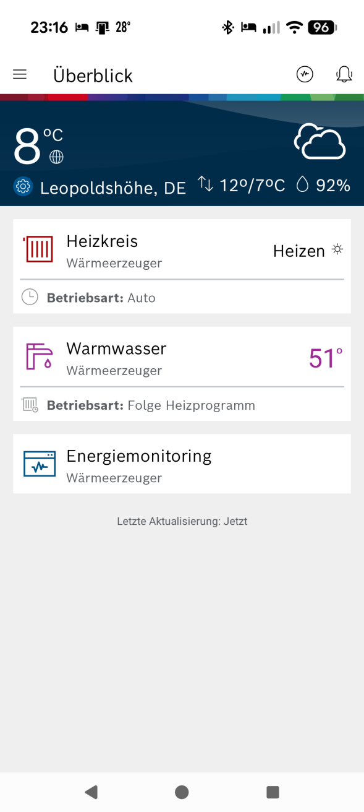

> **Beschreibung:** Screenshot der Überblicksseite mit Außentemperatur 8 °C und Ortsangabe Leopoldshöhe. Darunter stehen drei Kacheln: Heizkreis (Status "Heizen", Betriebsart Auto), Warmwasser (51 °) und Energiemonitoring. Die Struktur zeigt die Geräteebenen einer Wärmeerzeuger-Anlage.

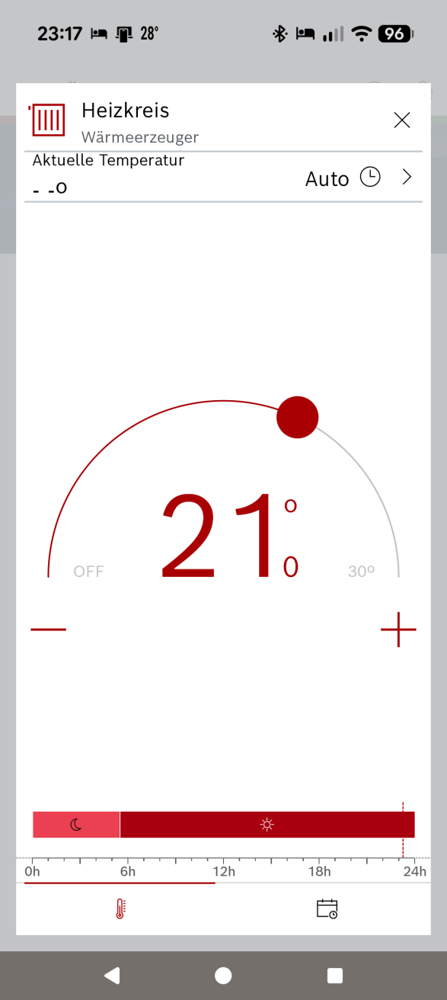

> **Beschreibung:** Screenshot der Heizkreis-Detailansicht mit einem halbkreisförmigen Drehregler (Skala OFF bis 30°), der auf 21° steht. Darunter zeigt eine 24-Stunden-Zeitleiste rote Balken für Nacht (Mond) und Tag (Sonne). Die Betriebsart ist mit "Auto" angegeben.

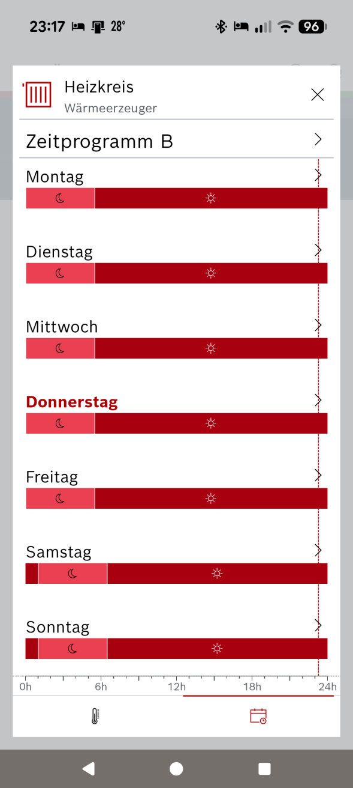

> **Beschreibung:** Screenshot des Zeitprogramms B mit einer Zeile je Wochentag von Montag bis Sonntag. Jede Zeile besteht aus einem Nachtabschnitt (dunkelrot, Mond) und einem Tagabschnitt (rot, Sonne) über 24 Stunden. Donnerstag ist rot hervorgehoben, Samstag und Sonntag weichen im Nachtabschnitt ab.

---

## Folie 61 — Praxis: Energiemonitoring

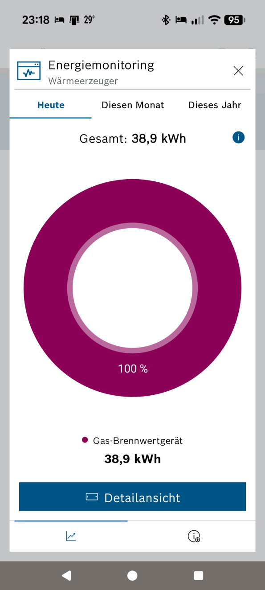

> **Beschreibung:** Screenshot des Energiemonitorings mit Reiter "Heute" und Gesamtwert 38,9 kWh. Ein vollständig magentafarbener Ring (100 %) steht für das Gas-Brennwertgerät, darunter ist derselbe Wert angegeben. Unten befindet sich die Schaltfläche "Detailansicht".

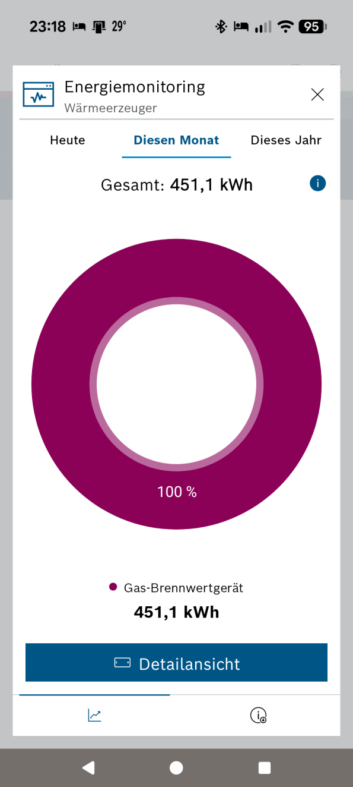

> **Beschreibung:** Screenshot mit Reiter "Diesen Monat" und Gesamtwert 451,1 kWh. Der Kreis ist wie auf der Heute-Ansicht vollständig magentafarben (100 %) und dem Gas-Brennwertgerät zugeordnet. Der Aufbau entspricht der Tagesansicht.

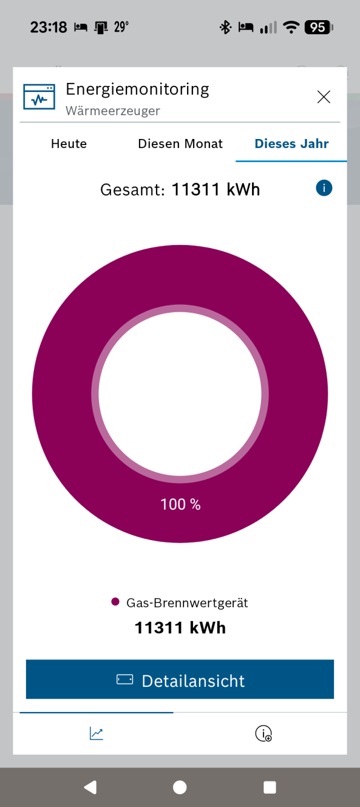

> **Beschreibung:** Screenshot mit Reiter "Dieses Jahr" und Gesamtwert 11311 kWh. Der magentafarbene Ring ist vollständig gefüllt (100 %) und das Gas-Brennwertgerät trägt denselben Wert. Die Ansicht dient dem Vergleich der Zeiträume.

---

## Folie 62 — Praxis: Energiemonitoring — Jahresverlauf

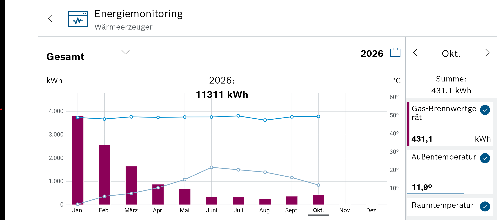

> **Beschreibung:** Kombiniertes Diagramm mit magentafarbenen Säulen für den Gasverbrauch in kWh von Januar bis Oktober 2026 (linke Achse 0 bis 4.000 kWh). Die Säulen fallen von rund 3.800 kWh im Januar auf unter 300 kWh im Sommer und steigen im Oktober wieder leicht auf 431,1 kWh (Werte grob abgelesen). Zwei Linien auf der rechten Achse in °C zeigen eine obere, nahezu konstante Linie um 50 °C (unbeschriftet) und eine untere, im Jahresverlauf steigende Außentemperatur-Linie. Im rechten Panel stehen die Summe für Oktober, die Außentemperatur von 11,9 °C und die Raumtemperatur.

---

## Folie 63 — Praxis: Wärmeerzeuger und Anlagen-Monitoring

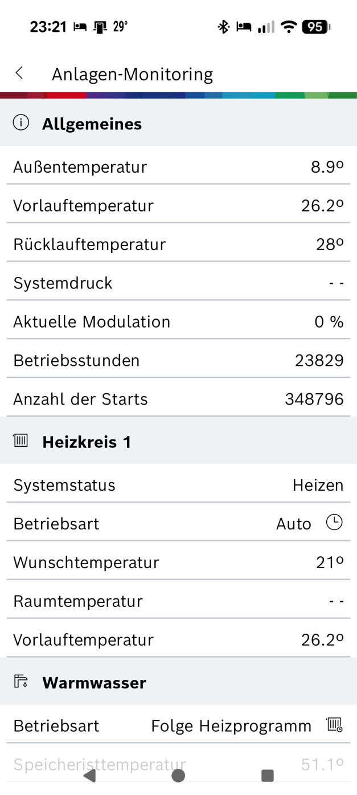

> **Beschreibung:** Screenshot des Menüs "Wärmeerzeuger" mit Gerätebild (Thermostat und Heizgerät) und gegliederten Menüpunkten. Die Gruppen sind Anlagen-Informationen (Anlagen-Monitoring, Konnektivitätsinformationen), Konfigurationen (Urlaubszeiten, Temperatureinstellungen, Systemmodus) und Geräteverwaltung (Datum und Uhrzeit, Servicepartner, Gerät entfernen in Rot). Der Aufbau ist eine einfache Listenansicht mit Pfeilen.

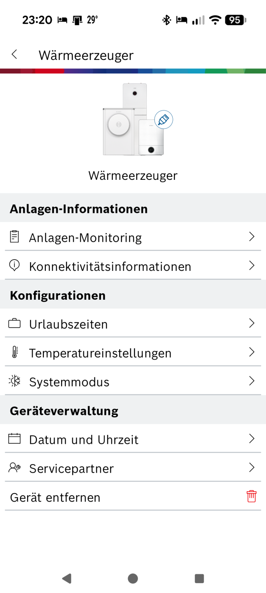

> **Beschreibung:** Screenshot der Liste "Anlagen-Monitoring" mit Messwerten in zwei Blöcken: Allgemeines (Außentemperatur 8,9 °, Vorlauf 26,2 °, Rücklauf 28 °, Betriebsstunden 23829, Anzahl der Starts 348796) und Heizkreis 1 (Systemstatus Heizen, Betriebsart Auto, Wunschtemperatur 21 °). Am unteren Rand beginnt der Block Warmwasser mit einer Speichertemperatur von 51,1 °. Die Darstellung ist tabellarisch mit Werten rechtsbündig.

---

## Folie 64 — Praxis: tado° App

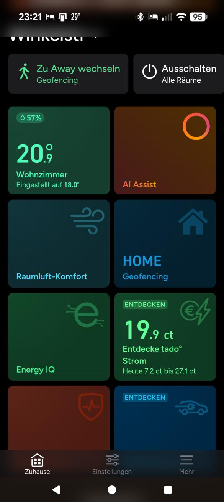

> **Beschreibung:** Screenshot der tado°-Startseite mit Schaltflächen "Zu Away wechseln" und "Ausschalten Alle Räume" oben. Kacheln zeigen Wohnzimmer (20,9 °, eingestellt auf 18 °, Luftfeuchte 57 %), AI Assist, Raumluft-Komfort, HOME Geofencing, Energy IQ und einen Strompreis von 19,9 ct. Dunkler Hintergrund mit grünen und blauen Akzenten.

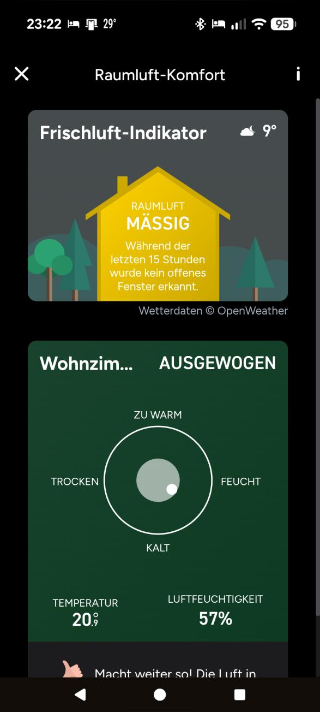

> **Beschreibung:** Screenshot der Wohnzimmer-Detailansicht mit Ist-Temperatur 20,9 °, Luftfeuchtigkeit 57 % und Solltemperatur 18,0 °. Den Mittelpunkt bildet ein vertikaler Schieberegler, dessen unterer Teil hell und dessen oberer Teil dunkel gefüllt ist. Unten steht der Hinweis "Danach: 20,0° am 23. Okt., 07:00".

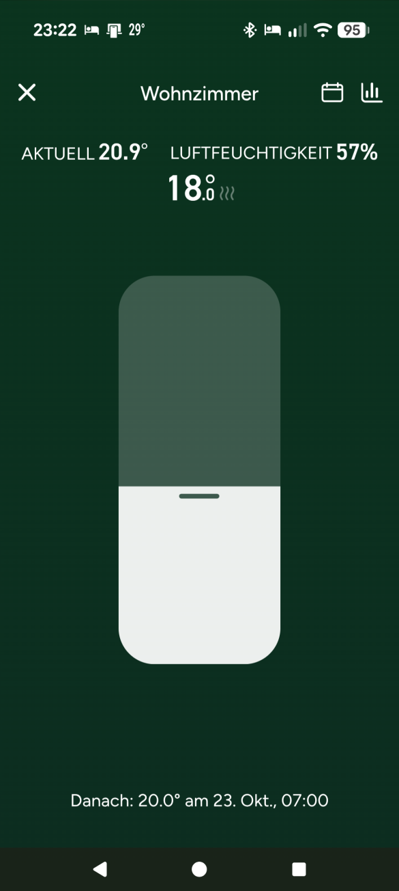

> **Beschreibung:** Screenshot der Raumluft-Komfort-Ansicht mit Kachel "Frischluft-Indikator" (Haus-Illustration, Hinweis "RAUMLUFT MÄSSIG", keine offenen Fenster in den letzten 15 Stunden, Datenquelle OpenWeather). Darunter zeigt die Kachel "Wohnzimmer: AUSGEWOGEN" ein Kreisdiagramm mit den Achsen ZU WARM, TROCKEN, FEUCHT und KALT. Temperatur 20,0° und Luftfeuchtigkeit 57 % sind als Kennzahlen unten angegeben.

---

## Folie 65 — Praxis: Kamera Hauseingang

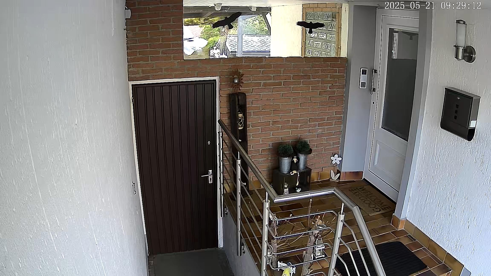

> **Beschreibung:** Standbild einer Überwachungskamera mit Blick auf einen Hauseingang: links eine dunkelbraune Haustür, rechts eine weiße Tür mit Briefkasten und Außenlampe, dazwischen eine Backsteinwand mit Blumentöpfen und einer Treppe mit Metallgeländer. Oben im Bild sind zwei dunkle Flugobjekte (vermutlich Vögel) zu sehen. Die eingeblendete Zeitangabe lautet 2025-05-21 09:29:12.

---

## Folie 66 — Home Assistant

Da es eine Fülle an verschiedenen Protokollen auf dem Markt gibt, die nicht miteinander kommunizieren, macht es Sinn eine Software und Server zu wählen, die die verschiedenen Dienste und Anbieter vereinen.

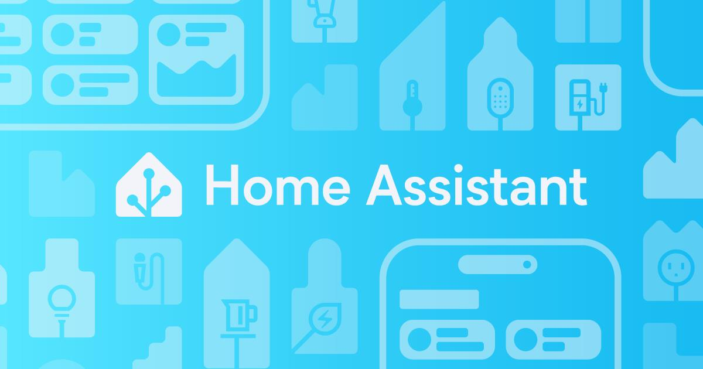

> **Beschreibung:** Werbebanner in Hellblau mit einem Muster aus weißen Smart-Home-Symbolen (Schalter, Steckdose, Haus, Lampe, Sensor). Im Vordergrund stehen das weiße Home-Assistant-Logo mit Haus-Icon und der Schriftzug "Home Assistant". Das Bild ist ein Markenmotiv und enthält keine Messwerte.

Home Assistant ist dafür ein Beispiel

---

## Folie 67 — Home Assistant: Dashboards & Automationen

- Smarte Automationen: Komplexe Bedingungen (z.B. Zeit, Anwesenheit, Helligkeit) verknüpfen
- Individuelle Dashboards: Vollständig anpassbare Oberflächen für Handys, Tablets oder Wanddisplays
- Integriertes Energiedashboard: Live-Überwachung von Stromverbrauch, PV-Anlage und Gas
- Lokale Sprachsteuerung: Private Sprachassistenten ganz ohne Amazon oder Google Clouds

---

## Folie 68 — Home Assistant: Grundprinzipien

<!-- NEU -->
*(Titel ergänzt — die Folie hatte im Original keine Überschrift.)*

- Open-Source-Software für die Hausautomatisierung
- Lokaler Fokus: Läuft autark ohne zwingende Cloudanbindung
- Herstellerunabhängig: Vereint Zigbee, Matter, Z-Wave, WLAN & Co.
- Hoher Datenschutz: Sensordaten und Kamerastreams bleiben im Haus

---

## Folie 69 — Hardware für Home Assistant OS

Home Assistant OS ist ein eigenständiges Linux Betriebssystem auf einem lokalen Server. Es hat nur geringe Anforderung an Hardware.

- **Einplatinencomputer:** Sehr beliebt auf dem Raspberry Pi 4 oder 5.
- **Mini-PCs:** x86-Plattformen wie ein Intel NUC oder gebrauchte Office-PCs (Thin Clients), die mehr Leistung bieten.
- **Fertigsysteme:** Hauseigene Hardware wie der *Home Assistant Green* oder *Yellow*.
- **Virtuelle Maschinen (VM):** Für fortgeschrittene Nutzer läuft HAOS auch hervorragend als VM auf Server-Systemen wie Proxmox

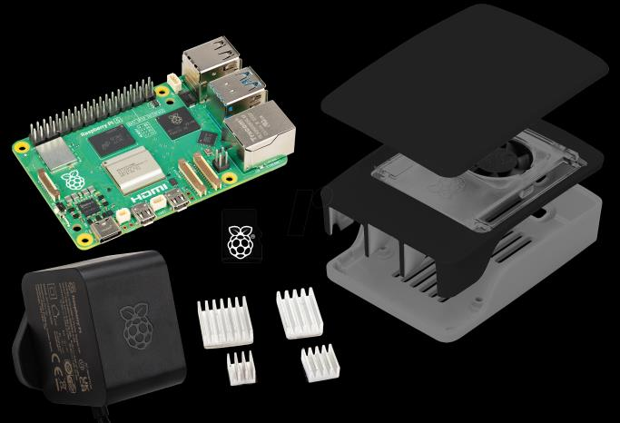

> **Beschreibung:** Freigestellte Produktfotos auf schwarzem Hintergrund zeigen einen Raspberry-Pi-Einplatinencomputer (grüne Platine mit Anschlüssen) neben Netzteil, weißen Kühlkörpern und einem Pi-Logo-Aufkleber. Rechts ist ein Gehäuse in explodierter Darstellung zu sehen: schwarzer Deckel, grau-weiße Basis und ein Lüfter. Das Bild veranschaulicht die Einplatinencomputer-Option als Hardwarebasis für Home Assistant OS.

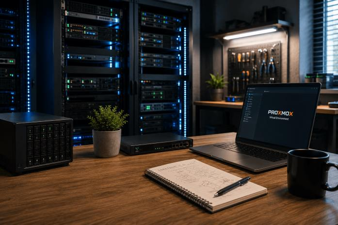

> **Beschreibung:** Fotorealistische Szene in einem Heimlabor mit Serverracks mit blau leuchtenden LED-Streifen im Hintergrund. Auf einem Holztisch stehen ein NAS-Gerät, ein Netzwerk-Switch, ein Laptop mit dem Schriftzug „PROXMOX Virtual Environment“, ein Notizblock und eine Kaffeetasse. Das Bild steht für den Betrieb von Home Assistant OS als virtuelle Maschine auf einem Server.

---

## Folie 70 — Unterschied zu anderen Varianten (z.B. Docker / Core)

Während du bei einer reinen Docker-Installation (Home Assistant Container) das Linux-Betriebssystem und alle Updates selbst über die Kommandozeile verwalten musst, nimmt HAOS dir diese Arbeit komplett ab. Dafür ist das System bei HAOS "abgeriegelt" – du kannst darauf keine anderen, Smart-Home-fremden Programme installieren.

---

## Folie 71 — Home Assistant: Integrationen (Screenshot)

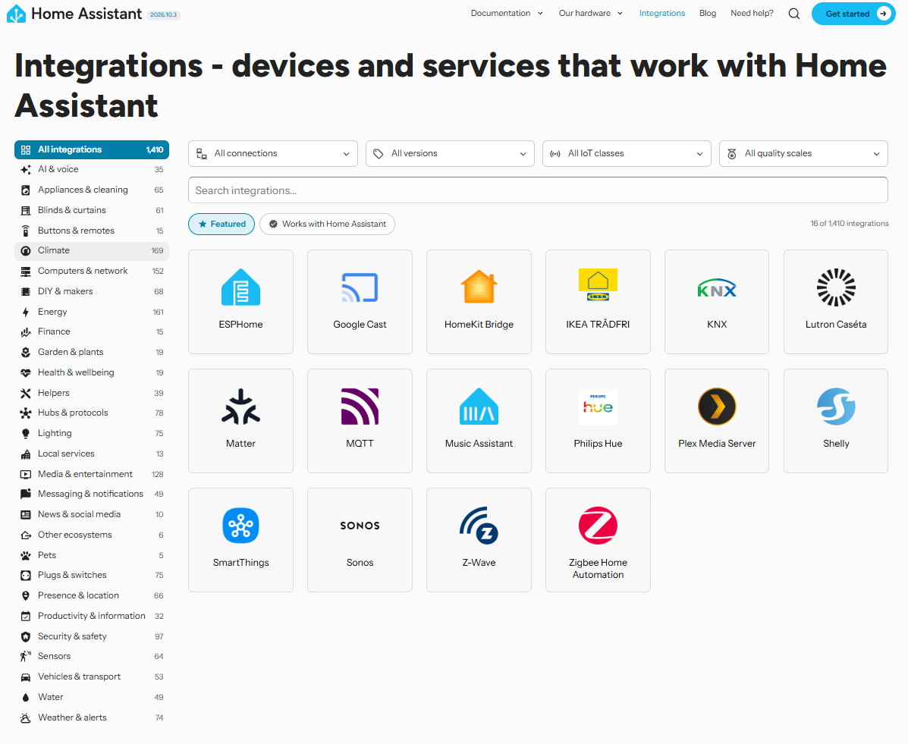

> **Beschreibung:** Screenshot der Website von Home Assistant mit dem Titel „Integrations – devices and services that work with Home Assistant“. Links steht eine vertikale Kategorienliste (z.B. Climate, Energy, Lighting, Security), rechts ein Raster mit Logos unterstützter Systeme wie ESPHome, Google Cast, HomeKit Bridge, IKEA TRÅDFRI, KNX, Matter, MQTT, Philips Hue, Shelly, SmartThings, Sonos, Z-Wave und Zigbee Home Automation. Die Darstellung in Weiß mit blauen Akzenten zeigt die Herstellerunabhängigkeit der Plattform.

---

## Folie 72 — Home Assistant: Dashboard (Screenshot)

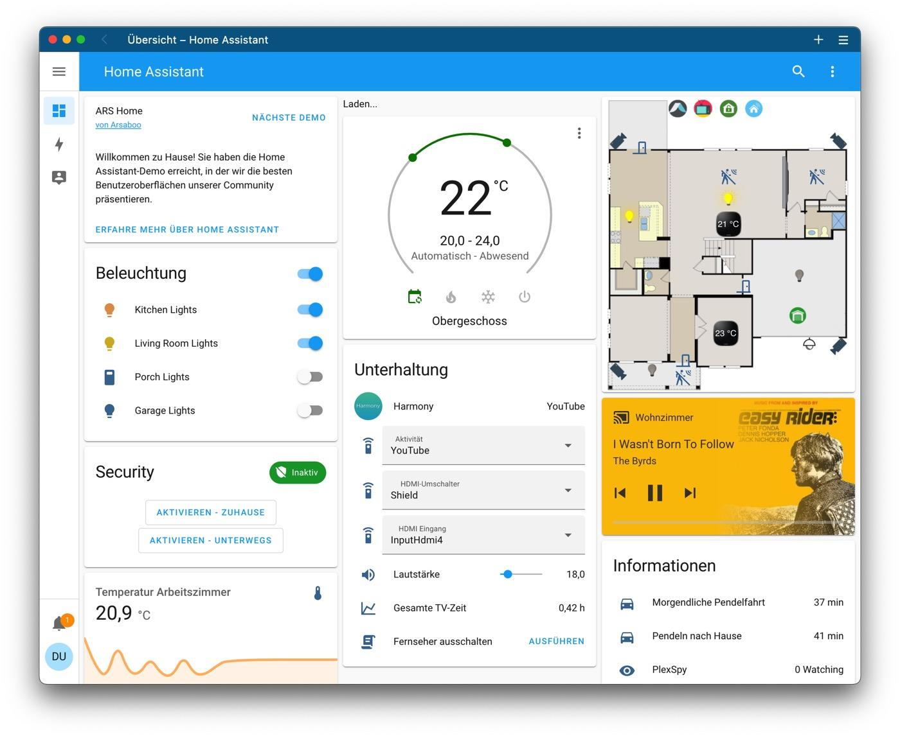

> **Beschreibung:** Screenshot des Home-Assistant-Dashboards („Übersicht“) in einem Browserfenster mit blauer Kopfleiste. Die Kartenstruktur zeigt Beleuchtung mit Schaltern (Kitchen Lights und Living Room Lights eingeschaltet), einen Thermostat mit 22 °C und Zieltemperaturbereich, eine Sicherheitskarte mit Buttons zum Aktivieren, eine Unterhaltungskarte (Harmony, Fernseher), einen Grundriss sowie ein Medien-Widget und Pendelinformationen. Das Bild verdeutlicht die frei gestaltbaren Kartenoberflächen.

---

## Folie 73 — Home Assistant auf Smartphone und Smartwatch

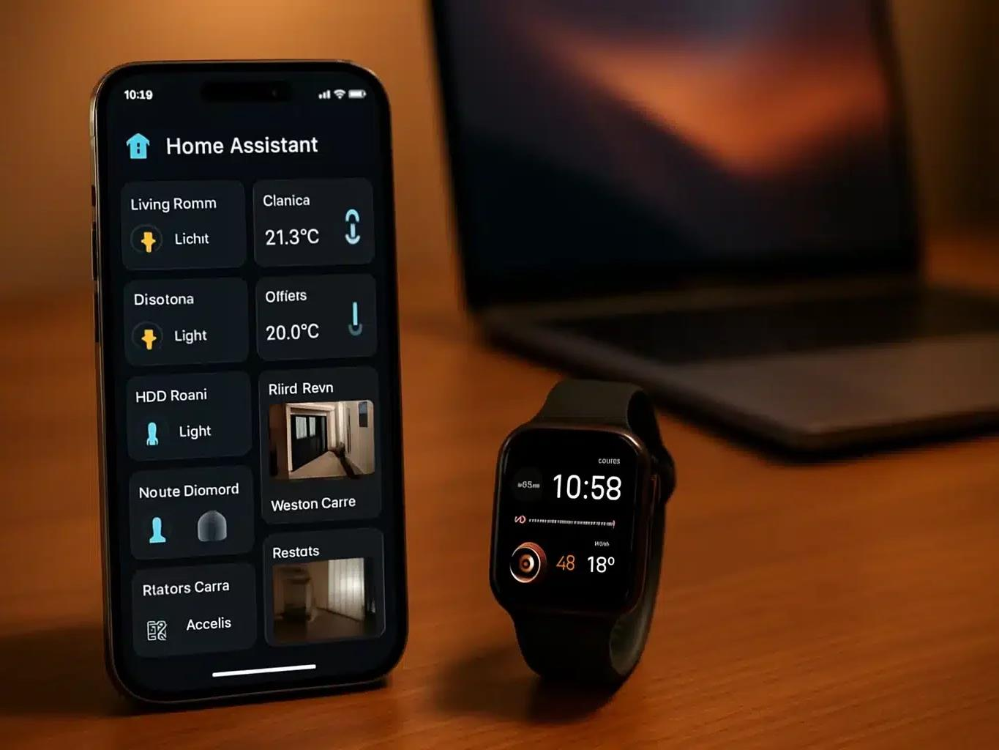

> **Beschreibung:** Fotografie auf einem warm beleuchteten Holztisch mit einem Smartphone im Vordergrund, auf dem die Home-Assistant-App mit Kacheln für Licht, Temperaturen (21,3 °C und 20,0 °C) und Kamera-Vorschauen zu sehen ist. Daneben steht eine Smartwatch mit der Uhrzeit 10:58 und Aktivitätsringen, im Hintergrund ist ein unscharfer Laptop zu erkennen. Einige Beschriftungen auf dem Display sind verzerrt und schlecht lesbar. Das Bild zeigt die mobile Nutzung der Steuerung auf Handy und Uhr.

---

## Folie 74 — Home Assistant: Wanddisplay / Tablet-Dashboard

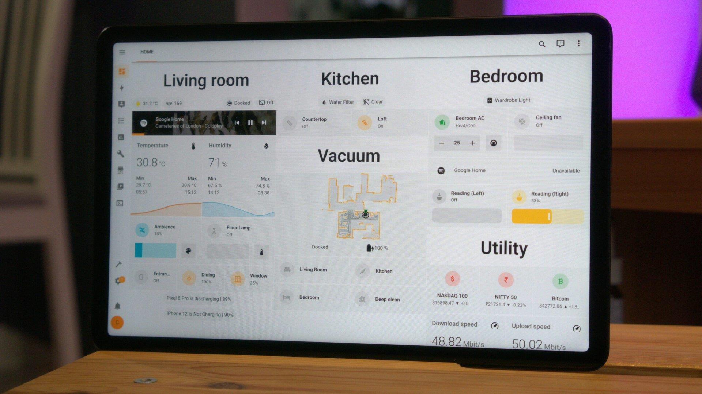

> **Beschreibung:** Foto eines auf einem Holztisch liegenden Tablets mit einem Dashboard, das nach Räumen gegliedert ist: Living room (30,8 °C, 71 % Luftfeuchte, Medienwidget), Kitchen und Vacuum mit Raumgrundriss und Ladestatus, Bedroom mit Klimaanlage (25 °C) und Lampen sowie eine Utility-Sektion. Darunter sind Kursinformationen (NASDAQ 100, Bitcoin) und Download-/Upload-Geschwindigkeiten (48,82 bzw. 50,02 Mbit/s) angezeigt. Das Bild steht für ein fest installiertes Wanddisplay mit individuellen Räumen und Statusinformationen.

---

## Folie 75 — Fazit Home Assistant

<!-- NEU -->
*(Im Original hieß diese Folie nur „Fazit" und las sich wie das Ende des Vortrags — es folgten aber noch 28 Folien. Umbenannt in „Fazit Home Assistant", weil sich der Satz ausschließlich auf Home Assistant bezieht. Das Gesamt-Fazit steht auf Folie 106.)*

Home Assistant bietet maximale Freiheit, absolute Datensicherheit und wächst flexibel mit jedem Projekt – vom Einsteiger bis zum Experten.

---

# Teil 6 — Workshop: drei Fälle

<!-- NEU -->
## Folie 76 — Teil 6: Workshop — drei Fälle

### Teil 6 — Workshop: drei Fälle

**Interaktiver Teil.** Drei Aufgaben, jede mit anschließender Auflösung:

1. **Neubau** — Einfamilienhaus wird neu errichtet
2. **Kernsanierung** — Einfamilienhaus Baujahr ~1960 wird saniert
3. **Mietwohnung** — Eigentums- oder Mietwohnung wird nachgerüstet

**Reihenfolge nach absteigender Eingriffstiefe.** Im Original kam die Sanierung zuerst und der Neubau zuletzt (und blieb unbeantwortet). Das funktionierte nicht: Die Sanierungs-Folien erklären jeden Punkt als Vergleich zum Neubau („Im Neubau: … / In der Kernsanierung: …"). Der Neubau ist die Referenz — also kommt er zuerst.

*(Kapiteltrennfolie — neu.)*

---

<!-- NEU -->
## Folie 77 — Das Raster für alle drei Fälle

Alle drei Fälle werden nach demselben Raster durchgegangen. So ist vergleichbar, was in welchem Fall möglich ist — und was nicht.

| Gewerk | Neubau | Kernsanierung | Mietwohnung |
|---|---|---|---|
| **1. Infrastruktur** | volle Freiheit: Bus, Sternverkabelung, Netzwerk | möglich, aber Statik und Platz setzen Grenzen | **entfällt** — kein Eingriff in die Bausubstanz |
| **2. Heizung, Lüftung & Klima** | kabelgebundene Einzelraumregelung | kabelgebunden, sofern Bodenaufbau es zulässt | Funk-Thermostate, zerstörungsfrei getauscht |
| **3. Beleuchtung & Beschattung** | zentrale Dimm-Aktoren, Rollladenmotoren ab Werk | nachrüstbar, Rollladenkästen oft zu eng | Leuchtmittel, Zwischenstecker, geklebte Taster; **Beschattung entfällt** |
| **4. Sicherheit & Zutritt** | Motorschloss, Reed-Kontakte ab Werk, PoE-Kameras | Motorschloss ja, Fensterkontakte schwierig | Aufsatz-Türschloss, geklebte Sensoren; **PoE-Kameras entfallen** |

**Eingriffstiefe:** Neubau = weißes Blatt → Kernsanierung = bestehende Substanz → Mietwohnung = nichts darf beschädigt werden.

> Die Werte in dieser Übersicht sind aus den Original-Folien F73–F92 abgeleitet; die Details stehen auf den folgenden Folien.

---

## Folie 78 — Fall 1 — Aufgabe: Neubau

### Aufgabe:

Ein **_Einfamilienhaus_** wird neu errichtet.

1. Welche Ausstattung ist möglich?
2. Welcher Übertragungsweg?
3. Welche Smarthome Komponenten machen in euren Augen Sinn

<!-- NEU -->
*(Im Original F94 lautete Frage 1 „Welche ist möglich?" — hier fehlte ein Wort. In Analogie zu F72/F87 („Welche Nachrüstung ist möglich?") und sinngemäß für den Neubau ergänzt zu „Welche Ausstattung ist möglich?", da beim Neubau nichts nachgerüstet, sondern von Anfang an geplant wird. Diese Aufgabe stand im Original ganz am Ende des Vortrags und blieb unbeantwortet — sie steht jetzt vorn und wird auf den Folien 79–84 aufgelöst.)*

---

<!-- NEU -->
## Folie 79 — Fall 1 — Neubau: Ausgangslage

Beim Neubau planst du auf einem **weißen Blatt Papier**. Es gibt keine bestehende Substanz, keine Statik-Rücksicht, keine Raumhöhen-Begrenzung und keinen Vermieter.

Das macht den Neubau zum **Referenzfall**: Hier ist alles möglich, was technisch sinnvoll ist. Die beiden folgenden Fälle — Kernsanierung und Mietwohnung — werden danach als *Einschränkungen gegenüber diesem Idealfall* behandelt.

**Übertragungsweg:** kabelgebunden. Ein Bus-System (KNX oder Loxone) ist im Neubau die naheliegende Wahl, weil die Wände ohnehin offen sind (siehe Folie 10: „Ideal für Neubau und Kernsanierung").

Die nächsten vier Folien gehen das Raster durch: **Infrastruktur → HVAC → Beleuchtung & Beschattung → Sicherheit & Zutritt**.

> **Quellenlage dieser Auflösung:** Die Folien 80–84 bestehen aus Originaltext. Material: die Gewerke-Übersicht F74–F78 sowie die „Im Neubau:"-Hälften der Vergleichsfolien F81–F84. Diese Hälften standen im Original im Sanierungsteil und sind hier in den Neubau-Teil verschoben; in der Kernsanierung (Folien 89–92) bleibt die „In der Kernsanierung:"-Hälfte.

---

## Folie 80 — Neubau — Infrastruktur (Das Fundament)

**1. Die Infrastruktur (Das Fundament)**

- **Bus-System (KNX oder Loxone):** Da die Wände ohnehin offen sind, solltest du grüne KNX-Busleitungen zu allen Schaltern, Sensoren und Präsenzmeldern legen. Dies ist der weltweite Standard für kabelgebundenes Smart Home. Es läuft extrem stabil, autark vom Internet und hält jahrzehntelang.
- **Sternverkabelung & Tiefe Unterputzdosen:** Lass alle Lichtauslässe, Steckdosen und Rollladenmotoren direkt in den zentralen Schaltschrank (Zählerplatz) ziehen. Verwende überall tiefe Elektronikdosen (z.B. von Kaiser), um später flexibel Aktoren oder smarte Klemmen nachzurüsten.
- **Netzwerk-Infrastruktur:** In jedes Zimmer gehören mindestens zwei Cat.7 oder Cat.8 Netzwerkkabel. Vergiss nicht, Kabelauslässe an den Decken für **Zentrale WLAN-Access-Points (PoE)** einzuplanen, um im ganzen Haus perfekten Empfang zu haben.

### Statik, Wände und Schlitze klopfen

- **Im Neubau:** Der Architekt plant die Schlitze und Durchbrüche direkt im Beton oder Mauerwerk ein. Kabeltrassen laufen sauber über den Rohboden, bevor der Estrich gegossen wird. Es gibt keine Einschränkungen bei der Platzierung von Schaltern oder Displays.

### Platz für den Schaltschrank (Der "Gehirn-Raum")

- **Im Neubau:** Der Hausanschlussraum wird von Anfang an groß genug geplant. Ein smarter Schaltschrank für ein Einfamilienhaus ist oft doppelt oder dreimal so groß wie ein Standard-Zählerkasten, da alle Aktoren und Netzteile dort Platz finden müssen.

---

## Folie 81 — Neubau — Heizung, Lüftung & Klima (HVAC)

**2. Heizung, Lüftung & Klima (HVAC)**

- **Smarte Heizungsaktoren:** Eine Einzelraumregelung ist Pflicht. Kabelgebundene Stellventile im Heizkreisverteiler, gesteuert über zentrale Smart-Home-Aktoren, arbeiten deutlich präziser als Funk-Thermostate.
- **Integrierte Raumklimasensoren:** Statt klobiger Thermostate an der Wand machen dezente Taster mit integrierten Temperatur- und Luftfeuchtigkeitssensoren Sinn.
- **Schnittstelle zur Wärmepumpe / Lüftungsanlage:** Achte darauf, dass deine neue Heizung über Modbus, LAN oder SG-Ready-Kontakte mit dem Smart Home kommunizieren kann, um PV-Strom optimal zu nutzen.

### Fußbodenaufbau und Heizung

- **Im Neubau:** Der Fußbodenaufbau (Dämmung + Estrich) ist hoch genug (meist 14–16 cm). Kabel und die Rohre der Fußbodenheizung haben nebeneinander perfekt Platz.

---

## Folie 82 — Neubau — Beleuchtung & Beschattung

**3. Beleuchtung & Beschattung**

- **Zentrale Dimm-Aktoren:** Nutze 24V-LED-Beleuchtung (DALI oder KNX) für dimmbares, flackerfreies Licht. Die Netzteile sitzen im Schaltschrank, nicht in der Decke.
- **Smarte Rollladen- / Jalousiemotoren:** Setze auf einfache, robuste 230V-Motoren ohne eigenen Funk. Die Intelligenz zieht in den Schaltschrank ein. So kann die Beschattung vollautomatisch nach Sonnenstand, Raumtemperatur und Windwächter gesteuert werden.
- **Präsenzmelder statt Bewegungsmelder:** Plane in Durchgangsräumen (Flur, Bad, Küche, Abstellraum) echte Präsenzmelder an der Decke ein. Sie erkennen auch, wenn du still am Schreibtisch sitzt oder in der Badewanne liegst, und machen klassische Lichtschalter fast überflüssig.

### Fenster und Verschattung

- **Im Neubau:** Fensterkontakte (Reed-Kontakte) und die Stromzuleitungen für Raffstores/Rollläden werden direkt ab Werk in die Maße der Rohbauöffnungen integriert.

<!-- NEU -->
> Die Fensterkontakte aus diesem Punkt gehören funktional zu **Sicherheit & Zutritt** (Folie 83) — sie werden aber im gleichen Arbeitsgang mit der Verschattung bestellt und sind deshalb hier mit aufgeführt.

---

## Folie 83 — Neubau — Sicherheit & Zutritt

**4. Sicherheit & Zutritt**

- **Motorschloss in der Haustür:** Lass direkt ein kabelgebundenes Motorschloss (z.B. von Fuhr oder KFV) in die Haustür einbauen. In Kombination mit einem Fingerprint-Reader oder Keypad öffnest du die Tür schlüssellos und sicher.
- **Fensterkontakte (Reed-Kontakte):** Bestelle die neuen Fenster direkt ab Werk mit integrierten, kabelgebundenen Reed-Kontakten im Rahmen. Damit weiß dein System, ob ein Fenster offen, gekippt oder verriegelt ist – essenziell für die Alarmanlage und die Heizungsabschaltung beim Lüften.
- **Kabel-Überwachungskameras:** Plane PoE-Kabel (Power over Ethernet) an den Hausecken ein. Kabelgebundene Kameras sind absolut manipulationssicher und benötigen keine Batterien.

---

## Folie 84 — Neubau — Wichtige Planungs-Tipps für die Praxis

**Wichtige Planungs-Tipps für die Praxis:**

1. **Gewerkeübergreifend denken:** Lass den Elektriker und den Heizungsbauer nicht isoliert arbeiten. Die Heizung muss wissen, was die Verschattung tut, und das Licht muss mit den Präsenzmeldern harmonieren.
2. **Der "Alles-Aus"-Schalter:** Plane neben der Haustür und dem Ehebett einen Taster ein, der mit einem Klick das gesamte Licht im Haus ausschaltet, die Heizung absenkt und die Beschattung in den Nachtmodus versetzt.
3. **Leerrohre, Leerrohre, Leerrohre:** Man kann nie genug haben. Vor allem zum Dachboden (für spätere PV-Anlagen) und in den Garten/Garage (für Wallboxen und Außenbeleuchtung).

<!-- NEU -->
> Diese drei Tipps gelten für die Kernsanierung genauso. Bei der Sanierung kommt Tipp 3 doppelt zum Tragen: Jedes Leerrohr, das jetzt nicht gelegt wird, bedeutet später wieder aufgeschlitzte Wände.

---

## Folie 85 — Fall 2 — Aufgabe: Kernsanierung

### Aufgabe:

Einfamilienhaus Baujahr ~1960 wird saniert.

1. Welche Nachrüstung ist möglich?
2. Welcher Übertragungsweg?
3. Welche Smarthome Komponenten machen in euren Augen Sinn

---

## Folie 86 — Fall 2 — Kernsanierung als Chance

Bei einer **Kernsanierung** hast du die einmalige Chance, Smart-Home-Komponenten direkt unter Putz zu verlegen und auf eine kabelgebundene, zukunftssichere Basis zu setzen. Das spart später teure Batteriewechsel, verhindert Funklöcher und steigert den Wiederverkaufswert deiner Immobilie massiv.

Hier ist eine Übersicht der Komponenten, die bei einer Kernsanierung den größten Sinn ergeben, aufgeteilt nach Gewerken.

<!-- NEU -->
> **Rückverweis:** Die hier angekündigte Gewerke-Übersicht steht in dieser Fassung auf den **Folien 80–84** (Neubau) — sie gilt für die Kernsanierung unverändert, weil beide Fälle ein kabelgebundenes System erlauben. Die folgenden Folien 89–92 zeigen nur noch, **wo die Kernsanierung vom Neubau abweicht**, Gewerk für Gewerk im gleichen Raster.

---

## Folie 87 — Frage: Sanierung vs. Neubau

Unterscheidet sich die Planung bei einer Sanierung gegenüber einer Planung bei einem Neubau?

---

## Folie 88 — Antwort: Sanierung vs. Neubau

**Ja,** die Planung unterscheidet sich in einigen wesentlichen Punkten, obwohl beide Projekte (Neubau und Kernsanierung) die Chance auf ein kabelgebundenes System (wie KNX oder Loxone) bieten. Während du beim Neubau auf einem **weißen Blatt Papier** planst, musst du bei der Kernsanierung immer mit der **bestehenden Substanz** klar kommen.

---

## Folie 89 — Sanierung — Infrastruktur: Statik, Wände und Schlitze klopfen

### 1. Statik, Wände und Schlitze klopfen

- **In der Kernsanierung: Die Statik setzt Grenzen.** Du darfst tragende Wände oder alte Betondecken nicht unbegrenzt horizontal aufschlitzen, um dicke Kabelbündel zu verlegen. Oft musst du auf Abhängecken (Trockenbau) oder Vorsatzschalen ausweichen, um die Busleitungen und die Sternverkabelung zum Schaltschrank zu führen.

<!-- NEU -->
> **Zum Vergleich — Neubau (Folie 80):** Dort plant der Architekt Schlitze und Durchbrüche von Anfang an ein, Kabeltrassen laufen über den Rohboden, es gibt keine Einschränkung bei der Platzierung von Schaltern.

---

## Folie 90 — Sanierung — Infrastruktur: Platz für den Schaltschrank (Der "Gehirn-Raum")

### 2. Platz für den Schaltschrank (Der "Gehirn-Raum")

- **In der Kernsanierung: Platzmangel ist das größte Problem.** Oft muss der neue, riesige Schaltschrank in einen engen Kellerflur oder eine Nische gequetscht werden. Hier ist eine extrem präzise Platzplanung im Vorfeld nötig – manchmal müssen Aktoren dezentral in tiefe Elektronikdosen in die Räume ausgelagert werden.

<!-- NEU -->
> **Zum Vergleich — Neubau (Folie 80):** Dort wird der Hausanschlussraum von Anfang an groß genug geplant, mit Platz für alle Aktoren und Netzteile.

---

## Folie 91 — Sanierung — HVAC: Fußbodenaufbau und Heizung

### 3. Fußbodenaufbau und Heizung

- **In der Kernsanierung:** Oft ist die Raumhöhe begrenzt und der alte Estrich kann nicht beliebig dick ersetzt werden. Wird eine Fußbodenheizung nachträglich eingefräst oder ein Dünnbettsystem genutzt, gibt es **keinen Platz auf dem Boden für Smart-Home-Kabel**. Diese müssen dann komplett über die Decke oder die Wände umgeleitet werden.

<!-- NEU -->
> **Zum Vergleich — Neubau (Folie 81):** Dort ist der Fußbodenaufbau mit meist 14–16 cm hoch genug, Kabel und Heizungsrohre liegen nebeneinander.

---

## Folie 92 — Sanierung — Beleuchtung & Beschattung: Fenster und Verschattung

### 4. Fenster und Verschattung

- **In der Kernsanierung:** Wenn die alten Fensterstürze (oft aus massivem Beton) erhalten bleiben, ist der Platz für elektrische Rollladenkästen extrem eng. Auch das nachträgliche Einbohren von Kabeln für Fensterkontakte in bestehende Rahmen erfordert chirurgische Präzision, damit die Dichtigkeit nicht leidet.

<!-- NEU -->
> **Zum Vergleich — Neubau (Folie 82):** Dort werden Reed-Kontakte und Stromzuleitungen für Raffstores/Rollläden ab Werk in die Maße der Rohbauöffnungen integriert.

---

<!-- NEU -->
## Folie 93 — Sanierung — Sicherheit & Zutritt

Zum vierten Punkt des Rasters nennt das Original keine eigene Vergleichsfolie. Aus den vorhandenen Angaben lässt sich ableiten:

- **Motorschloss in der Haustür:** unverändert möglich wie im Neubau (Folie 83) — die Haustür wird bei einer Kernsanierung in der Regel ohnehin ersetzt.
- **Fensterkontakte:** nur dann unproblematisch, wenn auch die Fenster neu bestellt werden. Bleiben die alten Rahmen, gilt die Einschränkung von Folie 92 (nachträgliches Einbohren, Dichtigkeit).
- **PoE-Kameras an den Hausecken:** möglich, solange für die Kabelführung nach außen ein Weg vorhanden ist (Leerrohr, Durchbruch, Fassadendämmung im gleichen Zug).
- **Präsenzmelder an der Decke:** nur mit abgehängter Decke oder Vorsatzschale wirtschaftlich — siehe Folie 89.

> Diese Folie ist abgeleitet, nicht aus dem Original übernommen. Sie schließt die Lücke, damit alle drei Fälle nach demselben Raster vollständig sind.

---

## Folie 94 — Sanierung — Hybrid-Lösung: Der Geheimtipp für die Kernsanierung

### Hybrid-Lösung: Der Geheimtipp für die Kernsanierung

Weil das Schlitzen von Wänden bei einer Sanierung extrem aufwendig und teuer ist, planen viele Sanierer ein **Hybrid-System**:

- **Kabel (Bus)** für die kritischen, unbeweglichen Infrastrukturen: Schaltschrank, Heizungsventile, Rollladenmotoren und Decken-Präsenzmelder.
- **Funk (z.B. KNX-RF oder Homematic IP wired/funk kombiniert)** für die Lichtschalter an den Wänden. So sparst du dir das vertikale Aufschlitzen der Wände zu jedem einzelnen Lichtschalter und klebst stattdessen flache Funktaster auf.

---

## Folie 95 — Fall 3 — Aufgabe: Eigentums- oder Mietwohnung

### Aufgabe:

Eine **Eigentums- oder Mietwohnung** wird nachgerüstet.

1. Welche Nachrüstung ist möglich?
2. Welcher Übertragungsweg?
3. Welche Smarthome Komponenten machen in euren Augen Sinn?

---

## Folie 96 — Fall 3 — Mietwohnung: Ausgangslage

<!-- NEU -->
*(Titel ergänzt — die Folie hatte im Original keine Überschrift.)*

Für eine **Mietwohnung** sind kabelgebundene Systeme wie KNX oder Loxone komplett vom Tisch. Hier ist Funk-Smart-Home dein perfekter Weg: Alle Komponenten werden einfach geklebt, gesteckt oder zerstörungsfrei ausgetauscht. Beim Auszug nimmst du alles rückstandslos mit in dein neues Zuhause.

Die folgenden Optionen und Systeme machen in einer Mietwohnung den größten Sinn, ohne dass du Ärger mit dem Vermieter riskierst.

---

## Folie 97 — Mietwohnung — Infrastruktur: Das passende Funksystem wählen

### 1. Das passende Funksystem wählen

Setze in einer Mietwohnung auf etablierte Funkstandards, damit du herstellerunabhängig bleiben kannst:

- **Matter & Thread:** Der neueste, zukunftssicherste Standard. Geräte verschiedener Marken (Apple, Google, Amazon, Eve etc.) arbeiten direkt und extrem schnell zusammen.
- **Zigbee:** Der absolute Klassiker für smarte Beleuchtung und Sensoren (z.B. Philips Hue, IKEA Dirigera, Aqara). Extrem energiesparend und baut ein stabiles "Mesh-Netzwerk" von Gerät zu Gerät auf.
- **Homematic IP / Bosch Smart Home:** Eigenständige Funksysteme (nutzen ein eigenes Frequenzband), die extrem zuverlässig für Heizung und Sicherheit funktionieren.

<!-- NEU -->
> **Entfällt gegenüber Neubau und Sanierung:** Bus-System (KNX/Loxone), Sternverkabelung in den Schaltschrank, tiefe Unterputzdosen, verlegte Netzwerkkabel, PoE-Access-Points in der Decke. Jeder dieser Punkte erfordert einen Eingriff in die Bausubstanz — in der Mietwohnung ist er nicht möglich. Das Funksystem von Folie 97 **ist** hier die Infrastruktur.

---

## Folie 98 — Mietwohnung — Heizung & Klima

### 2. Die besten Komponenten für Mietwohnungen

**Heizung & Klima**

- **Smarte Heizkörperthermostate:** Das bringt in Mietwohnungen oft die größte Ersparnis. Du schraubst das alte Thermostat per Hand (oder Rohrzange) ab und das neue (z.B. **Eve Thermo**, **Homematic IP** oder **tado°**) an.
- *Wichtig:* Die alten Thermostate unbedingt aufbewahren!

<!-- NEU -->
> **Entfällt:** kabelgebundene Stellventile im Heizkreisverteiler, zentrale Heizungsaktoren im Schaltschrank, Taster mit integrierten Raumklimasensoren, Schnittstelle zur Wärmepumpe oder Lüftungsanlage (Modbus / SG-Ready). Alles davon setzt Zugriff auf die Anlagentechnik voraus, die in der Mietwohnung nicht dem Bewohner gehört. Die Funk-Thermostate arbeiten laut Folie 81 weniger präzise als kabelgebundene Stellventile — das ist der Preis der Rückbaubarkeit.

---

## Folie 99 — Mietwohnung — Beleuchtung & Strom

> **Beschreibung:** Kleines Icon einer leuchtenden gelben Glühbirne auf schwarzem Hintergrund. Es steht als Symbol links neben der Zwischenüberschrift "Beleuchtung & Strom" und kennzeichnet den Themenblock Licht und Strom.

**Beleuchtung & Strom**

- **Smarte Leuchtmittel (Plug & Play):** Tausche einfach die vorhandenen Glühbirnen gegen smarte LEDs (z.B. **Philips Hue** oder **IKEA Tradfri**). Die alten Leuchtmittel bewahrst du für den Auszug auf.
- **Smarte Zwischenstecker (Plugs):** Damit machst du Stehlampen, Kaffeemaschinen oder den Ventilator fit fürs Smart Home. Sie werden einfach in die Steckdose gesteckt.
- **Smarte Schalter zum Überkleben:** Damit niemand den physischen Lichtschalter ausschaltet (wodurch smarte Lampen stromlos und offline wären), gibt es Halterungen oder flache Funktaster (z.B. von Hue oder Senic), die einfach über oder neben die alten Schalter an die Wand geklebt werden.

<!-- NEU -->
> **Entfällt:** die gesamte **Beschattung**. Smarte Rollladen- und Jalousiemotoren, Windwächter und Sonnenstands-Automatik gehören zum Gebäude, nicht zur Wohnung — in der Mietwohnung entfällt dieses Gewerk vollständig. Ebenso entfallen zentrale Dimm-Aktoren im Schaltschrank, 24V-DALI/KNX-Beleuchtung und Decken-Präsenzmelder (Bohren in die Decke, Stromzuführung). Ersatz für Präsenzmelder: freistehende oder geklebte Funk-Bewegungsmelder — mit der Einschränkung von Folie 82, dass Bewegungsmelder stillsitzende Personen nicht erkennen.

---

## Folie 100 — Mietwohnung — Zutritt & Sicherheit

<!-- NEU -->
*(Titel aus dem Original übernommen; Raster-Position 4.)*

- **Smarte Türschlösser (Nachrüst-Sets):** Systeme wie das **Nuki Smart Lock** oder **Yale Linus** werden einfach von innen auf deinen bestehenden Schließzylinder aufgesetzt (oft nur geklemmt oder geklebt). Von außen sieht man nichts, dein physischer Schlüssel funktioniert weiterhin, und du musst kein Schloss austauschen.
- **Geklebte Sensoren:** Fenster- und Türkontakte sowie Bewegungsmelder von Marken wie **Aqara** oder **Eve** sind winzig und werden komplett mit spurlos ablösbaren Klebestreifen befestigt.

<!-- NEU -->
> **Entfällt:** kabelgebundenes Motorschloss in der Haustür (Folie 83) — die Wohnungstür darf nicht umgebaut werden, und die Haustür des Gebäudes gehört ohnehin allen Mietern. Ebenso entfallen Reed-Kontakte ab Werk im Fensterrahmen und **PoE-Überwachungskameras an den Hausecken**: Außenkameras erfassen Gemeinschaftsflächen und Nachbarn und sind in einem Mehrparteienhaus kein Alleingang des Mieters. Hier ist vorher mit Vermieter und Hausgemeinschaft zu klären, was zulässig ist.

---

<!-- NEU -->
## Folie 101 — Mietwohnung — Was entfällt: die ehrliche Bilanz

| Gewerk | In der Mietwohnung möglich | Entfällt |
|---|---|---|
| **1. Infrastruktur** | Funkstandard als Infrastruktur: Matter/Thread, Zigbee, Homematic IP | Bus-System, Sternverkabelung, Schaltschrank, verlegtes Netzwerk, PoE-Access-Points |
| **2. Heizung & Klima** | Funk-Heizkörperthermostate (alte aufbewahren!) | kabelgebundene Stellventile, zentrale Aktoren, Anlagen-Schnittstellen (Modbus/SG-Ready) |
| **3. Beleuchtung & Strom** | smarte Leuchtmittel, Zwischenstecker, geklebte Funktaster, geklebte Bewegungsmelder | **Beschattung komplett**, zentrale Dimm-Aktoren, 24V-DALI/KNX, Decken-Präsenzmelder |
| **4. Zutritt & Sicherheit** | Aufsatz-Türschloss, geklebte Fenster-/Türkontakte | Motorschloss, Reed-Kontakte ab Werk, PoE-Außenkameras |

### Die Leitlinie für diesen Fall

**Alles muss rückstandslos entfernbar sein.** Geklebt, gesteckt oder von Hand getauscht — nichts gebohrt, nichts geschlitzt, nichts an der Anlagentechnik.

**Preis dafür:** geringere Präzision bei der Heizungsregelung, Batterien statt Dauerstrom, kein Zugriff auf Beschattung und Anlagentechnik.

**Vorteil dafür:** Beim Auszug zieht das ganze Smart Home mit um. Bei KNX bleibt es in der Wand.

---

# Teil 7 — Entscheidung & Abschluss

<!-- NEU -->
## Folie 102 — Teil 7: Entscheidung & Abschluss

### Teil 7 — Entscheidung & Abschluss

- Entscheidungshilfe: welches System für welchen Fall
- Kosten: Größenordnungen
- Energieeinsparung: was noch zu belegen ist
- Gesamt-Fazit
- Quellen & offene Belege
- Fragen

*(Dieser ganze Teil fehlte im Original. Kapiteltrennfolie — neu.)*

---

<!-- NEU -->
## Folie 103 — Entscheidungshilfe: Welches System für welchen Fall?

Aus der Vergleichsmatrix (Folie 26/42) und den drei Workshop-Fällen (Teil 6) ergibt sich:

| Fall | Übertragungsweg | Systemempfehlung | Begründung aus dem Vortrag |
|---|---|---|---|
| **Neubau** | Kabel (Bus) | **KNX oder Loxone**, Zentrale lokal (z. B. Home Assistant) | Wände offen → einmalige Chance; „extrem stabil, autark vom Internet, hält jahrzehntelang" (Folie 80) |
| **Kernsanierung** | Kabel, wo möglich; sonst Hybrid | **Bus für Festinstallation + Funk für Wandtaster** (Folie 94) | Statik und Platz setzen Grenzen (Folien 89–92); Schlitzen ist der Kostentreiber |
| **Mietwohnung** | Funk | **Matter/Thread oder Zigbee** | lokal, energiesparend, rückstandslos entfernbar (Folien 97, 101) |
| **Einzelne Geräte, Einstieg, Budget** | WLAN | **Tuya** — bewusst und nur für Unkritisches | sehr günstig, riesige Auswahl, aber Cloud-Zwang (Folien 27/28) |
| **Datenschutz ist das Hauptkriterium** | beliebig | **lokale Zentrale**: Home Assistant, oder deutscher Anbieter (Teil 5, Block A) | Daten verlassen das Haus nicht (Folie 46) |

### Die drei Fragen, die die Entscheidung tragen

1. **Wie tief darf ich in das Gebäude eingreifen?** → bestimmt Kabel oder Funk.
2. **Muss das System ohne Internet funktionieren?** → bestimmt lokal oder Cloud.
3. **Über welchen Zeitraum soll es halten?** → bestimmt Bus/lokal (Jahrzehnte) oder Cloud (Serverbetrieb, Folie 48).

**Faustregel:** Je unbeweglicher die Komponente, desto eher Kabel. Je kritischer die Funktion (Türschloss, Kamera, Heizung), desto eher lokal.

---

<!-- NEU -->
## Folie 104 — Kosten: Größenordnungen

> ### ⚠️ ALLE ZAHLEN AUF DIESER FOLIE SIND PLATZHALTER
> Die Original-Präsentation enthält **keine einzige Kostenangabe**. Die Felder unten sind bewusst leer gelassen und müssen vor dem Vortrag mit **eigenen, belegbaren Zahlen** gefüllt werden — aus Angeboten, Preislisten oder abgerechneten Projekten. Erfundene Zahlen sind an dieser Stelle schlimmer als keine Zahlen, weil die Kostenfrage im Publikum sofort kommt und eine falsche Zahl den ganzen Vortrag beschädigt.

### Was zu befüllen ist

| Position | Neubau (KNX/Bus) | Kernsanierung (Hybrid) | Mietwohnung (Funk) |
|---|---|---|---|
| Material gesamt, Einfamilienhaus ~150 m² | ___ € | ___ € | ___ € |
| Installation / Elektriker-Stunden | ___ € | ___ € | entfällt (Eigenleistung) |
| Programmierung / Inbetriebnahme | ___ € | ___ € | entfällt |
| Zentrale (Hub / Server) | ___ € | ___ € | ___ € |
| **Summe** | ___ € | ___ € | ___ € |

### Einzelpositionen, die das Publikum konkret fragt

| Komponente | Preisspanne | Quelle |
|---|---|---|
| KNX-Schaltaktor (Reihe) | ___ € | zu ergänzen |
| KNX-Taster mit Sensorik | ___ € | zu ergänzen |
| Zigbee-Heizkörperthermostat | ___ € | zu ergänzen |
| Matter-Steckdose | ___ € | zu ergänzen |
| Tuya-WLAN-Steckdose | ___ € | zu ergänzen |
| Aufsatz-Türschloss (Nuki / Yale) | ___ € | zu ergänzen |
| Raspberry Pi 5 + Zubehör für HAOS | ___ € | zu ergänzen |
| Busleitung pro Meter | ___ € | zu ergänzen |

### Was sich ohne Zahlen schon sagen lässt

Diese Rangfolge steht bereits im Original und braucht keine Preisangabe:

- Kabel (KNX/Loxone) ist die „**teuerste Variante**" (Folie 10).
- Matter-Hardware ist „**meist teurer** als einfache Tuya- oder reine Zigbee-Komponenten" (Folie 36).
- Tuya ist „**sehr günstig**" bei „extrem vielen" Geräten (Folie 27).
- Der eigentliche Kostentreiber bei der Sanierung ist **nicht die Hardware, sondern das Schlitzen der Wände** — deshalb das Hybrid-System auf Folie 94.

**Reihenfolge nach Preisniveau (ohne Beträge, aus dem Original ableitbar):** Tuya < Zigbee < Matter < KNX/Loxone.

---

<!-- NEU -->
## Folie 105 — Energieeinsparung: was noch zu belegen ist

> ### ⚠️ KEINE EINSPARUNGSZAHL IM VORTRAG BELEGT
> Folie 5 nennt „effizienter Energienutzung gewährleisten" als einen von vier Zwecken des Smart Homes. Die Folien 61–63 zeigen ein Energiemonitoring mit echten Werten. **Eine Einsparungszahl wird nirgends genannt** — weder in Prozent noch in Euro noch in kWh.
> Diese Folie ist ein Platzhalter. Die Zahl darf nicht geschätzt werden.

### Was konkret zu belegen ist

| Aussage | Was als Beleg taugt | Status |
|---|---|---|
| „Einzelraumregelung spart ___ %" | eigener Verbrauchsvergleich vor/nach Umbau, gleiche Heizperiode, witterungsbereinigt | offen |
| „Smarte Thermostate in der Mietwohnung bringen die größte Ersparnis" (Folie 98) | Messung in mindestens einer Heizperiode | **Aussage steht im Original, unbelegt** |
| „Automatische Beschattung senkt den Kühlbedarf um ___ %" | Studie oder Herstellerangabe mit Messmethode | offen |
| „Abschaltung beim Lüften über Fensterkontakte spart ___ kWh" | Verbrauchsdaten mit/ohne Automatik | offen |

### Die Datengrundlage liegt schon vor

Die eigene Anlage protokolliert bereits alles Nötige (Folien 61–63). Die folgenden Werte sind **aus den Screenshots abgelesen, nicht aus der Anlage exportiert** — vor Verwendung am Gerät oder in der App gegenprüfen:

- Tages-, Monats- und Jahresverbrauch des Gas-Brennwertgeräts (Folie 61)
- Jahresverlauf Januar bis Oktober mit Außen- und Raumtemperatur (Folie 62)
- Betriebsstunden und Anzahl der Brennerstarts (Folie 63)

**Der ehrliche Vorschlag für den Vortrag:** Statt einer geschätzten Prozentzahl die eigenen Monatswerte zweier Heizperioden gegenüberstellen und sagen, was die Automatik verändert hat — und wo die Messung an ihre Grenzen kommt (anderes Wetter, anderes Nutzerverhalten). Das ist belegbar und überzeugender als eine Zahl aus einer Werbebroschüre.

> ### Möglicher Aufhänger — erst prüfen, dann zeigen
> Das Anlagen-Monitoring auf Folie 63 zeigt Betriebsstunden und Brennerstarts nebeneinander. Setzt man beide ins Verhältnis, ergibt sich eine **auffällig hohe Zahl von Starts pro Betriebsstunde** — also genau das „Takten", das die Hysterese aus Teil 2 verhindern soll (Folie 21).
>
> **Diese Rechnung ist nicht belegt.** Die Ausgangswerte sind aus einem Screenshot abgelesen, nicht aus der Anlage exportiert, und die Zählweise des Geräts ist unbekannt (zählt es Brennerstarts, Pumpenstarts oder Reglerzyklen? über welchen Zeitraum?). Vor dem Vortrag am Gerät verifizieren.
>
> Trägt die Zahl, ist das der stärkste Aufhänger für den Hysterese-Exkurs, den dieser Foliensatz hat — mit eigenen Anlagendaten statt einer fremden Studie. Trägt sie nicht, bleibt der Exkurs ohne diesen Einstieg bestehen.

---

<!-- NEU -->
## Folie 106 — Gesamt-Fazit

### Die vier Sätze, die aus diesem Vortrag bleiben sollten

**1. Smart Home ist ein Vier-Schichten-Modell, nicht ein Produkt.**
Feldebene (Sensoren/Aktoren) → Übertragungsebene (Funk oder Kabel) → Steuerungsebene (die Zentrale) → Bedienebene (App, Sprache, Taster). Wer eine Entscheidung trifft, trifft sie immer auf einer dieser vier Schichten — und meistens auf der zweiten.

**2. Die wichtigste Entscheidung ist lokal gegen Cloud.**
Nicht die Marke, nicht die App, nicht der Preis. Lokal (Zigbee, Matter, KNX, Home Assistant) heißt: funktioniert ohne Internet, Daten bleiben im Haus, Gerät überlebt den Hersteller. Cloud heißt: Komfort beim Einrichten, Abhängigkeit im Betrieb.

**3. Der Bau bestimmt die Technik, nicht umgekehrt.**
Neubau → Kabel. Kernsanierung → Hybrid. Mietwohnung → Funk. Die Eingriffstiefe des Gebäudes entscheidet, nicht die Vorliebe für ein System.

**4. Die Risiken sind nicht nur Datenschutz.**
Datenschutz, IT-Sicherheit und Lebensdauer sind drei getrennte Risiken. Ein Gerät kann DSGVO-konform und trotzdem unsicher sein — oder sicher und trotzdem in drei Jahren Elektroschrott.

### Was in diesem Vortrag offen bleibt

- **Kosten** — keine belegten Zahlen (Folie 104)
- **Energieeinsparung** — keine belegte Zahl, aber die Messdaten liegen vor (Folie 105)
- **Rechtsaussagen in Teil 4** — unbelegt, zu prüfen (Folie 107)

Diese drei Punkte offen zu benennen ist seriöser, als sie zu füllen.

---

<!-- NEU -->
## Folie 107 — Quellen & offene Belege

### Im Vortrag verwendete Abbildungen

Alle Screenshots aus Teil 5 (Folien 57–65) und Teil 2 (Folien 20, 22–24) stammen aus der **eigenen Installation** des Vortragenden. Produktbilder und Logos (Folien 52–55, 66) sind Herstellermaterial. Das Instagram-Beispiel auf Folie 14 stammt vom Elektrobetrieb *domhoeferelektrotechnik*.

### Offene Belege — vor dem Vortrag zu klären

| Nr. | Aussage | Wo | Status |
|---|---|---|---|
| 1 | Definition und Zweck der Hysterese | Folie 21 | Das Original verwies auf „[1, 2]". Ein Literaturverzeichnis existiert nicht, die Marker lösen nirgends auf. **Quelle nachzutragen** (Fachliteratur Heizungstechnik oder Herstellerdokumentation). |
| 2 | „Hosten personenbezogener Daten in China … in den allermeisten Fällen unzulässig" | Folie 45 | **Rechtsaussage ohne Quelle.** Zu belegen über eine Veröffentlichung der Aufsichtsbehörden oder des EDSA — oder abzuschwächen. |
| 3 | Kein Angemessenheitsbeschluss der EU-Kommission für China | Folie 45 | **Zu belegen** (Liste der Angemessenheitsbeschlüsse der EU-Kommission). |
| 4 | „Artikel 7 des chinesischen Geheimdienstgesetzes" verpflichtet zur Kooperation | Folie 45 | **Zu belegen** über den Gesetzestext bzw. eine zitierfähige Übersetzung. Artikelnummer und Wortlaut prüfen. |
| 5 | Zwingende TIA-Pflicht und „fast immer negatives Ergebnis" deutscher Aufsichtsbehörden | Folie 45 | **Zu belegen.** „Fast immer" ist eine quantitative Aussage ohne Grundlage in der Präsentation. |
| 6 | CLOUD-Act-Risiko bei US-Anbietern mit Servern in Frankfurt | Folie 44 (Bildinhalt) | Stammt aus der abgebildeten Tabelle; **Primärquelle der Tabelle nicht genannt**. |
| 7 | IT-Sicherheitsgrundsätze (offene Ports, Firmware-Updates, Botnetze) | Folie 47 | Neu ergänzt, ohne Zitat. **Mit BSI-Empfehlungen zu Smart Home / IoT unterfüttern.** |
| 8 | Konkreter Fall einer abgeschalteten Hersteller-Cloud | Folie 48 | **Bewusst kein Beispiel benannt**, weil die Präsentation keines nennt. Für den Vortrag ein belegtes Beispiel ergänzen. |
| 9 | Kostenangaben | Folie 104 | **Vollständig offen**, alle Felder Platzhalter. |
| 10 | Einsparungszahlen | Folie 105 | **Vollständig offen**; Datengrundlage aus dem eigenen Energiemonitoring vorhanden. |
| 10a | Verhältnis Brennerstarts zu Betriebsstunden („Takten") | Folie 105 | **Nicht belegt.** Ausgangswerte aus einem Screenshot abgelesen, nicht exportiert; Zählweise des Geräts unbekannt. Am Gerät verifizieren, bevor die Zahl im Vortrag genannt wird. |
| 11 | „Moonshot AI (Kimi K3)" | Anhang (gestrichene F43) | **Modellbezeichnung zweifelhaft — nicht bestätigen.** Die Passage ist aus dem Vortrag herausgenommen; falls sie zurückkehrt, ist die Bezeichnung zu prüfen. |
| 12 | Zuordnung der Praxis-Screenshots zu Anbietern | Folien 59–65 | Teilweise nur aus dem Bildinhalt abgeleitet. **Anbieter vom Vortragenden bestätigen lassen.** |

### Hinweis zur Rechtslage

Die rechtlichen Aussagen in Teil 4 sind der Original-Präsentation entnommen und in dieser Fassung **nicht verschärft und nicht erweitert** worden. Sie sind keine Rechtsberatung. Für eine belastbare Bewertung eines konkreten Systems ist eine datenschutzrechtliche Prüfung erforderlich.

---

## Folie 108 — Fragen?

<!-- NEU -->
### Fragen? / Q&A

Danke für die Aufmerksamkeit.

**Was gern gefragt werden darf:**

- Welches System für meinen konkreten Fall? → Folie 103
- Was kostet das? → Folie 104 (Zahlen offen, ehrlich gesagt)
- Spart das wirklich Energie? → Folie 105 (Messdaten vorhanden, Zahl noch nicht gerechnet)
- Was passiert mit meinen Daten? → Folie 46

> **Beschreibung:** Quadratische Illustration im Vintage-Look mit dunkelbraunem Hintergrund. Im Zentrum steht ein türkisfarbener Delfin mit geöffnetem Maul vor einer roten, konzentrischen Zielscheibe mit Rasterstruktur. Oben steht in cremefarbener Schrift „So long and…“ im Retro-Stil, darunter ein geschwungener englischer Abschiedsspruch in Schreibschrift mit Schattenwurf. Die Grafik ist ein humorvoller Abschiedsgruß und hat keinen inhaltlichen Bezug zum Smart-Home-Thema.

---

# Anhang — Gestrichenes Material

<!-- NEU -->
In diesem Anhang stehen alle Original-Passagen, die aus dem Foliensatz entfernt oder stark verdichtet wurden — **wörtlich und vollständig**, damit nichts verloren geht. Keine dieser Passagen ist gelöscht; sie sind nur nicht mehr Teil des Vortrags.

---

<!-- NEU -->
## A1 — Original-Agenda (F2)

Ersetzt durch die vollständige Agenda auf Folie 3. Grund: Die Originalliste nannte sieben Punkte plus „UVM" und deckte die Folien F72–F97 (Workshop, interaktiv — rund ein Viertel des Vortrags) überhaupt nicht ab.

Originaltext:

> - Was ist Smart Home?
> - Was ist ihr Zweck
> - Aufbau von Smart Home
> - Die Funktion
> - Welche Anbieter gibt es
> - Gefahren von Smart Home
> - UVM

---

<!-- NEU -->
## A2 — Langfassung der Datenschutz-Folien (F39, F40, F41, F42)

Verdichtet auf Folie 45. Die Originaltexte im Wortlaut:

### F39 — Datenschutz: Hosting von Daten in China

> Das Hosten von personenbezogenen Daten auf einem Server in China ist nach der DSGVO **rechtlich extrem riskant** und in den allermeisten Fällen **unzulässig**.
>
> Da China aus Sicht der EU als unsicheres Drittland gilt und kein Angemessenheitsbeschluss der EU-Kommission vorliegt, müssen für einen solchen Datentransfer extrem strenge Hürden genommen werden. In der Praxis scheitern DSGVO-konforme Lösungen meist an den weitreichenden staatlichen Überwachungsgesetzen in China.

### F40 — Kein Angemessenheitsbeschluss (China)

> **1) Kein Angemessenheitsbeschluss:** Die Europäische Kommission stuft das Datenschutzniveau in China nicht als gleichwertig mit dem europäischen Standard ein.

### F41 — Zugriffsrisiko durch Behörden

> **2) Zugriffsrisiko durch Behörden (Geheimdienstgesetz):**
> Selbst wenn Sie Verträge mit einem Cloud-Anbieter in China abschließen, verpflichtet Artikel 7 des chinesischen Geheimdienstgesetzes dortige Organisationen und Unternehmen zur Kooperation mit den staatlichen Sicherheitsbehörden. Ein wirksamer Schutz vor staatlichem Zugriff ist damit kaum zu garantiere

*(Der Satz bricht im Original mitten im Wort ab — „zu garantiere". Auf Folie 45 ist er zu „zu garantieren." vervollständigt; inhaltlich wurde nichts hinzugefügt.)*

### F42 — Scheitern von Standardvertragsklauseln

> **3) Scheitern von Standardvertragsklauseln (SCCs):** Zwar können Unternehmen theoretisch Standardvertragsklauseln (SCC) vereinbaren. Im Rahmen des zwingend erforderlichen *Transfer Impact Assessments (TIA)* muss jedoch geprüft werden, ob das Recht des Drittlandes die Einhaltung der SCCs aushebelt. Wegen der chinesischen Überwachungsgesetze kommen deutsche Aufsichtsbehörden hier fast immer zu einem negativen Ergebnis.

---

<!-- NEU -->
## A3 — Gestrichen: KI-Modelle & APIs (F43)

**Grund für die Streichung:** kein Smart-Home-Bezug. Die Folie behandelt Cloud-KI-Dienste und Unternehmens-IT, nicht Gebäudetechnik.

**Zusätzliche Warnung:** Die Modellbezeichnung „Kimi K3" ist zweifelhaft und in dieser Fassung **nicht bestätigt**. Falls die Passage zurück in den Vortrag soll, ist die Bezeichnung zuerst zu prüfen (siehe Quellenfolie 107, Nr. 11).

Originaltext:

> **KI-Modelle & APIs:**
> Prominente Fälle wie der chinesische Chatbot DeepSeek oder die Modelle von Moonshot AI (Kimi K3) dürfen mit personenbezogenen Daten europäischer Nutzer in Unternehmen **nicht direkt in der Cloud-Variante** genutzt werden, da die Daten auf Servern in der Volksrepublik China landen. Hier wird stattdessen die Nutzung von Open-Source-Modellen auf *lokalen, selbst gehosteten Servern (self-hosted)* in Europa empfohlen.

---

<!-- NEU -->
## A4 — Gestrichen: Social Media (F44)

**Grund für die Streichung:** kein Smart-Home-Bezug. Die Folie behandelt ein Social-Media-Verfahren, nicht Gebäudetechnik. Die enthaltene Aussage über Verfahren und Bußgelder ist zudem unbelegt.

Originaltext:

> **Social Media:** Gegen Plattformen wie TikTok wurden bereits massive DSGVO-Verfahren und Bußgelder durch europäische Behörden (wie der irischen DPC) eingeleitet, weil europäische Nutzerdaten auf Servern in China gespeichert oder dorthin übertragen wurden.

---

<!-- NEU -->
## A5 — Gestrichen: Echte Anonymisierung (F45)

**Grund für die Streichung:** kein Smart-Home-Bezug, und für den Anwendungsfall nicht tragfähig — Smart-Home-Daten (Anwesenheit, Schaltzeiten, Kamerabilder eines einzelnen Haushalts) sind praktisch nicht anonymisierbar, weil sie per Definition einem Haushalt zugeordnet sind. Die Passage steht hier unverändert und ohne Zuspitzung.

Originaltext:

> **Echte Anonymisierung:** Wenn die Daten auf dem Server in China absolut keinen Personenbezug mehr aufweisen (und auch nicht wieder identifiziert werden können), greift die DSGVO nicht.

---

<!-- NEU -->
## A6 — Original-Foliennummern der Leerfolien

Diese Folien enthielten im Original ausschließlich Hintergrund und Fußzeile, keine Inhalte. Sie sind als Kapiteltrennfolien recycelt (siehe Mapping-Tabelle am Dateianfang):

| Alt | Originalinhalt | Neue Verwendung |
|---|---|---|
| F70 | „Keine Textinhalte; nur Foliennummer und Fußzeile." | Folie 2 — Kapiteltrenner Teil 0 |
| F71 | „Leerfolie, nur Hintergrund und Fußzeile." | Folie 6 — Kapiteltrenner Teil 1 |
| F86 | „Keine Textinhalte. Reine Hintergrundfolie." | Folie 19 — Kapiteltrenner Teil 2 |
| F93 | „Folie ohne Textinhalt und ohne Schaubild (nur Hintergrund und Fußzeile)." | Folie 25 — Kapiteltrenner Teil 3 |
| F95 | „Folie ohne Textinhalt und ohne Schaubild (nur Hintergrund und Fußzeile)." | Folie 43 — Kapiteltrenner Teil 4 |
| F96 | „Folie ohne Textinhalt und ohne Schaubild (nur Hintergrund und Fußzeile)." | Folie 49 — Kapiteltrenner Teil 5 |

Die Kapiteltrenner für **Teil 6** (Folie 76) und **Teil 7** (Folie 102) sind vollständig neu — es standen nur sechs Leerfolien für acht Teile zur Verfügung.

Folie **F97** (Abschiedsmotiv) ist nicht recycelt, sondern bleibt als Abschlussfolie am Ende (Folie 108).

---
